# W.O.O.H.O.O. Discovery Engine
## Where Only Our Heroes Orbit Outward

<p align="center">
  <strong>EXPLORE BEYOND THE KNOWN.</strong>
  <br/>
  An AI-powered scientific discovery, computational physics, and machine learning platform.
</p>

<p align="center">
  
  
  
  
</p>

<p align="center">
  
  
  
  
  
  
</p>

---

# TABLE OF CONTENTS

1. [Project Overview](#1-project-overview)
2. [Scientific Vision and Research Objectives](#2-scientific-vision-and-research-objectives)
3. [Platform Architecture](#3-platform-architecture)
4. [Artificial Intelligence Core](#4-artificial-intelligence-core)
5. [Machine Learning and Neural Architectures](#5-machine-learning-and-neural-architectures)
6. [Scientific Discovery and Automated Research](#6-scientific-discovery-and-automated-research)
7. [Astrophysics and Exoplanet Intelligence](#7-astrophysics-and-exoplanet-intelligence)
8. [Cosmology and Dark Matter Intelligence](#8-cosmology-and-dark-matter-intelligence)
9. [Quantum Computing and Quantum Machine Learning](#9-quantum-computing-and-quantum-machine-learning)
10. [Particle Physics Intelligence](#10-particle-physics-intelligence)
11. [Materials Science and Atomic Simulation](#11-materials-science-and-atomic-simulation)
12. [Plasma Physics and Fusion Research](#12-plasma-physics-and-fusion-research)
13. [Computational Physics and Numerical Simulation](#13-computational-physics-and-numerical-simulation)
14. [Advanced 3D Visualization Engine](#14-advanced-3d-visualization-engine)
15. [Virtual Observatory and Space Mission Intelligence](#15-virtual-observatory-and-space-mission-intelligence)
16. [Scientific Data Intelligence Infrastructure](#16-scientific-data-intelligence-infrastructure)
17. [Multi-Agent Scientific Research](#17-multi-agent-scientific-research)
18. [Database Architecture](#18-database-architecture)
19. [API Architecture](#19-api-architecture)
20. [Security and Scientific Integrity](#20-security-and-scientific-integrity)
21. [Installation and Configuration](#21-installation-and-configuration)
22. [Testing and Evaluation](#22-testing-and-evaluation)
23. [Deployment and Infrastructure](#23-deployment-and-infrastructure)
24. [Project Structure](#24-project-structure)
25. [Future Research Directions](#25-future-research-directions)

---

# 1. PROJECT OVERVIEW

## 1.1 Introduction

**W.O.O.H.O.O. — Where Only Our Heroes Orbit Outward** is an integrated artificial intelligence and scientific computing platform designed to bring machine learning, computational physics, astronomical research, quantum computing, scientific simulations and interactive 3D visualization into one extensible software environment.

The platform combines modern AI architectures with established mathematical and physical computation methods.

Rather than functioning as a general-purpose conversational AI application, W.O.O.H.O.O. provides specialized scientific tools capable of interacting with datasets, numerical solvers, mathematical models, trained machine learning systems and computational experiments.

The platform is designed around a unified research workflow:

1. Discover scientific datasets.
2. Inspect and validate observations.
3. Formulate research questions.
4. Generate testable hypotheses.
5. Configure mathematical and physical models.
6. Execute computational experiments.
7. Train machine learning models.
8. Evaluate predictions and uncertainty.
9. Compare results against reference calculations.
10. Visualize scientific outputs in interactive 3D.
11. Generate reproducible research reports.

W.O.O.H.O.O. connects multiple scientific disciplines through a shared AI intelligence layer and standardized computational infrastructure.

## 1.2 Core Product Philosophy

The central philosophy is:

**Artificial intelligence should not simply describe scientific phenomena. It should help researchers investigate, model, simulate, analyze and test them.**

This principle drives the platform's architecture.

Every major scientific module connects to shared services for:

- Dataset management.
- Machine learning.
- Mathematical computation.
- Physics simulation.
- Scientific reasoning.
- Experiment orchestration.
- Uncertainty analysis.
- Data provenance.
- Interactive visualization.

This enables users to conduct research across several disciplines without requiring disconnected software environments.

## 1.3 Platform Capabilities

| Research category | Major capabilities |
|---|---|
| Artificial Intelligence | Multimodal AI, scientific reasoning, research agents |
| Machine Learning | CNNs, Transformers, GNNs, PINNs, neural operators |
| Astrophysics | Exoplanet detection, gravitational lensing, black hole research |
| Cosmology | Cosmic web analysis, dark matter, expansion history |
| Quantum Computing | Circuit simulation, QML, quantum information |
| Particle Physics | Event reconstruction, detector intelligence, particle classification |
| Materials Science | Crystal structures, DFT, neural interatomic potentials |
| Plasma Physics | MHD, turbulence analysis, fusion research |
| Computational Physics | ODEs, PDEs, numerical solvers, inverse problems |
| Space Science | Virtual observatory, orbital mechanics, mission simulation |
| Visualization | Interactive 3D scientific environments |

## 1.4 Target Users

W.O.O.H.O.O. is designed for:

- AI and machine learning engineers.
- Computational physicists.
- Astrophysics researchers.
- Quantum computing developers.
- Scientific software engineers.
- Data scientists.
- Astronomy enthusiasts.
- Computational materials researchers.
- Physics educators.
- Students and independent scientific researchers.

## 1.5 Product Identity

**Name:** W.O.O.H.O.O. Discovery Engine

**Full Name:** Where Only Our Heroes Orbit Outward

**Tagline:** Explore Beyond the Known.

**Product Category:** Scientific Artificial Intelligence and Computational Discovery Software.

**Core Concept:** A connected research environment where artificial intelligence, machine learning and computational physics work together to investigate the universe and physical systems.

---

# 2. SCIENTIFIC VISION AND RESEARCH OBJECTIVES

## 2.1 Unified Scientific Research Environment

The platform is designed to connect scientific disciplines that traditionally use separate datasets, computational environments and analytical tools.

Its architecture supports cross-disciplinary experimentation.

For example:

- Astrophysical observations can become machine learning datasets.
- Numerical physics simulations can generate training data.
- Neural networks can approximate computationally expensive physical models.
- Quantum algorithms can be investigated through simulation.
- Materials structures can be represented using graph neural networks.
- Cosmological simulations can be analyzed using volumetric machine learning.
- Particle detector measurements can be reconstructed and visualized in 3D.

The objective is to create shared scientific infrastructure rather than isolated demonstrations.

## 2.2 Research Workflow

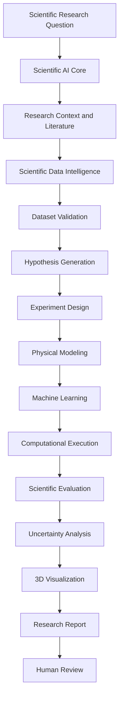

## 2.3 Cross-Disciplinary Research

The platform supports the development of interconnected scientific applications.

| Scientific discipline | Data | AI application | Computational application |
|---|---|---|---|
| Astrophysics | Telescope observations | Exoplanet classification | Orbital dynamics |
| Cosmology | Galaxy catalogs | Cosmic structure classification | N-body simulations |
| Quantum physics | Quantum states | Quantum ML | Circuit simulation |
| Particle physics | Collision events | Track reconstruction | Detector modeling |
| Materials science | Crystal structures | Property prediction | Molecular dynamics |
| Plasma physics | Plasma measurements | Turbulence forecasting | MHD simulations |
| Fluid mechanics | Flow fields | Neural operators | Navier–Stokes solvers |

## 2.4 Scientific Reproducibility

All major computational workflows should record:

- Dataset provenance.
- Model version.
- Software version.
- Input parameters.
- Preprocessing configuration.
- Mathematical assumptions.
- Numerical solver.
- Computational settings.
- Evaluation methodology.
- Output artifacts.
- Uncertainty information.

This makes experimental results traceable and repeatable.

---

# 3. PLATFORM ARCHITECTURE

## 3.1 High-Level System Architecture

W.O.O.H.O.O. uses a modular architecture consisting of a frontend research environment, backend scientific computing services, machine learning infrastructure, persistent storage and visualization engines.

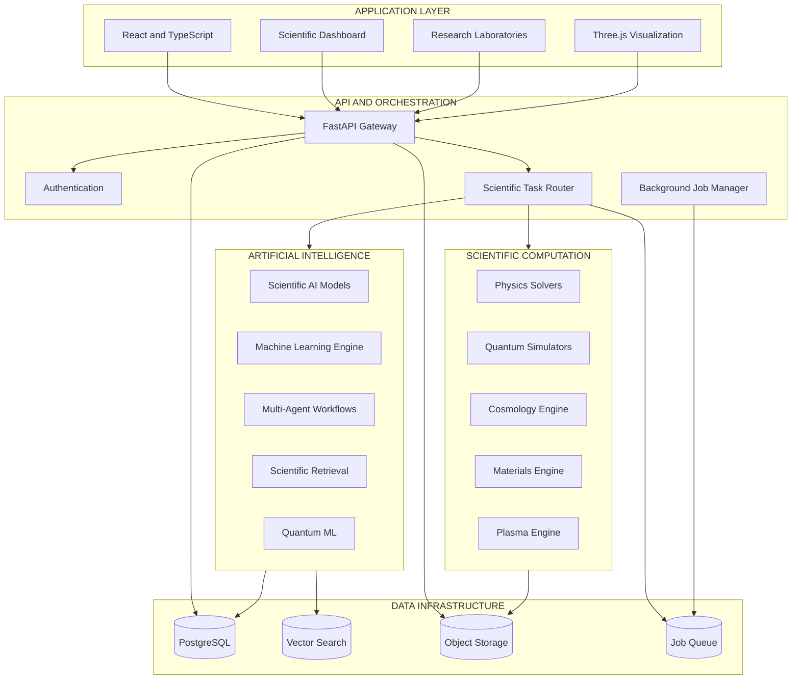

## 3.2 Frontend Architecture

The frontend provides the primary research interface.

Core technologies:

- React.
- TypeScript.
- Vite.
- Tailwind CSS.
- Three.js.
- React Three Fiber.
- Drei.
- Interactive charting libraries.
- KaTeX or MathJax.

The frontend is responsible for:

- Scientific dashboards.
- Research navigation.
- Dataset exploration.
- Model configuration.
- Experiment management.
- Interactive visualizations.
- Results interpretation.
- Export workflows.

Heavy numerical computation and model training are delegated to backend services.

## 3.3 Backend Architecture

Python-based services provide the scientific computation layer.

Primary technologies:

- FastAPI.
- NumPy.
- SciPy.
- SymPy.
- Pandas.
- PyTorch.
- JAX.
- scikit-learn.
- PyTorch Geometric.

Responsibilities:

- Scientific calculations.
- ML inference.
- Model training.
- Dataset preprocessing.
- Simulation orchestration.
- API integrations.
- Experiment execution.
- Report generation.

## 3.4 Service-Oriented Design

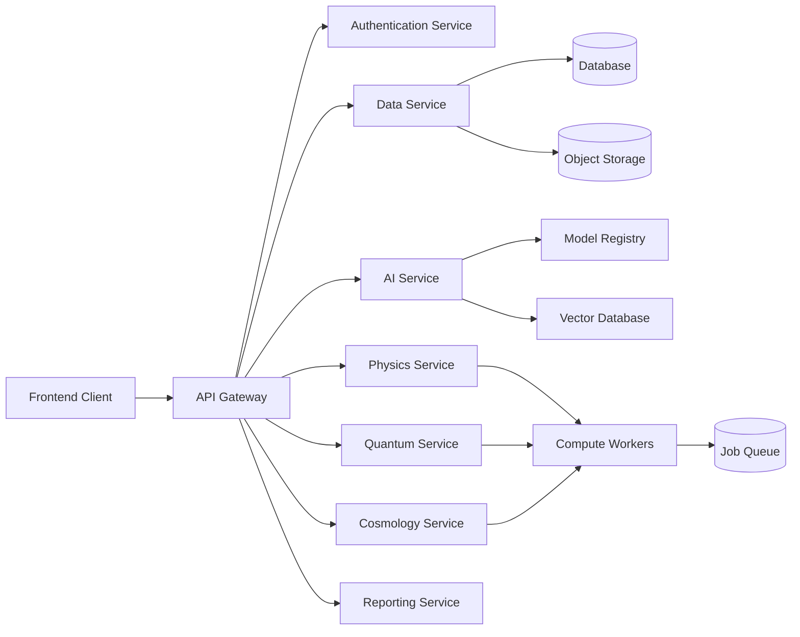

## 3.5 Asynchronous Computation

Long-running tasks are executed through background workers.

Examples:

- Model training.
- Large dataset preprocessing.
- DFT calculations.
- Molecular dynamics.
- Cosmological simulations.
- Quantum circuit simulation.
- Plasma simulation.
- Large-scale 3D data preparation.

Jobs have unique identifiers and execution states.

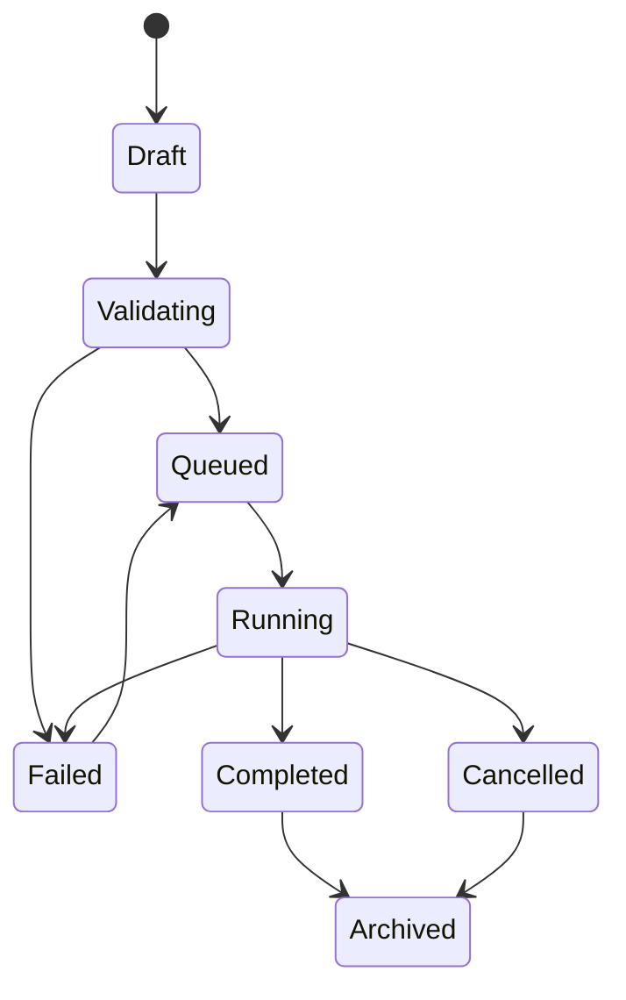

---

# 4. ARTIFICIAL INTELLIGENCE CORE

## 4.1 Scientific AI Intelligence Center

The Scientific AI Core coordinates the platform's AI capabilities.

Its main responsibilities are:

- Scientific task classification.
- Intelligent model routing.
- Context retrieval.
- Tool invocation.
- Dataset discovery.
- Model inference.
- Scientific calculations.
- Result evaluation.
- Uncertainty presentation.
- Research workflow orchestration.

Rather than sending every request to the same language model, the system routes tasks to specialized models and tools.

## 4.2 Intelligent Task Routing

Supported task types:

| Task | Computational service |
|---|---|
| Scientific question | Research language model |
| Mathematical equation | SymPy or numerical computation |
| Image analysis | Computer vision model |
| Time-series analysis | Temporal ML model |
| Dataset analysis | Data intelligence service |
| Quantum circuit | Quantum simulator |
| Physical simulation | Physics computation service |
| Cosmological inference | Cosmology engine |
| Model evaluation | ML evaluation service |
| Research report | AI reporting workflow |

Example routing architecture:

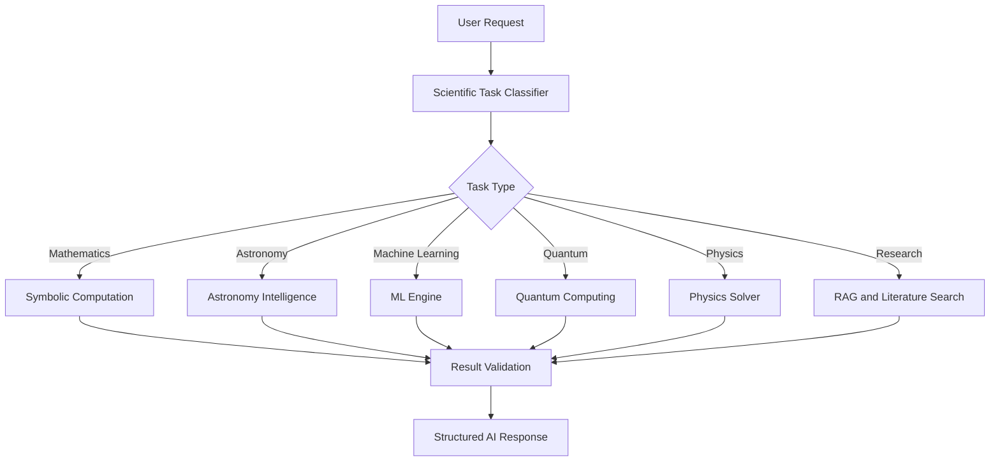

## 4.3 Scientific Tool Use

The AI can invoke approved computational operations.

Examples:

```python
analyze_dataset()
inspect_dataset_schema()
calculate_physical_quantity()
solve_differential_equation()
run_orbit_simulation()
analyze_light_curve()
classify_scientific_image()
evaluate_model()
inspect_uncertainty()
compare_experiments()
generate_scientific_report()
```

Each tool has typed inputs, validation rules, execution permissions and structured outputs.

The AI must use actual computation outputs when reporting a calculated result.

## 4.4 Multimodal Scientific Intelligence

The system supports multiple scientific data modalities:

- Images.
- Numerical tables.
- Time-series.
- Waveforms.
- Graphs.
- Atomic structures.
- Physical equations.
- Simulation fields.
- Research documents.

Modality-specific encoders produce representations that can be combined through supported fusion architectures.

## 4.5 Retrieval-Augmented Generation

The research assistant uses a retrieval pipeline.

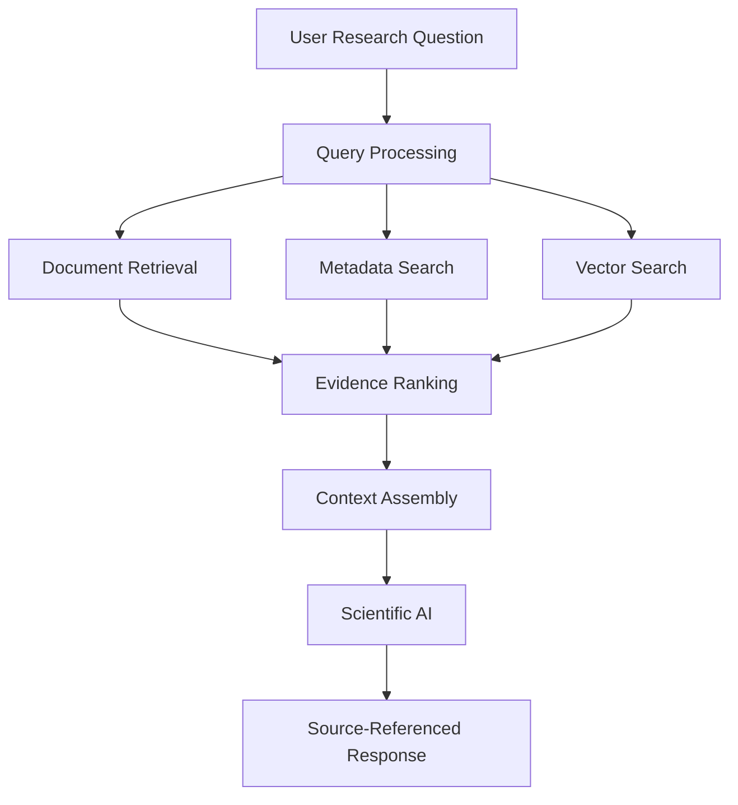

The retrieval environment indexes:

- Scientific literature.
- Research documentation.
- Dataset metadata.
- Model documentation.
- Mathematical references.
- Experiment history.
- User research notes.

Source attribution is retained.

## 4.6 AI Reliability

Implement:

- Prediction calibration.
- Uncertainty estimation.
- Distribution shift detection.
- Out-of-distribution detection.
- Model comparison.
- Error analysis.
- Input validation.
- Tool execution verification.

The AI must distinguish established scientific knowledge, published findings, numerical simulations, model predictions and unvalidated hypotheses.

---

# 5. MACHINE LEARNING AND NEURAL ARCHITECTURES

## 5.1 Neural Science Lab

The platform includes a dedicated machine learning research environment.

Supported model families include:

| Architecture | Scientific applications |
|---|---|
| CNN | Scientific image recognition |
| Vision Transformer | Astronomical imagery |
| Temporal Transformer | Scientific time-series |
| LSTM / GRU | Sequential prediction |
| GNN | Particle and atomic structures |
| Autoencoder | Anomaly detection |
| VAE | Latent representation learning |
| PINN | Physics-constrained learning |
| Neural Operators | PDE approximation |
| Bayesian Neural Networks | Predictive uncertainty |
| Diffusion Models | Scientific data generation |
| Equivariant Networks | Geometric physical systems |

## 5.2 Training Pipeline

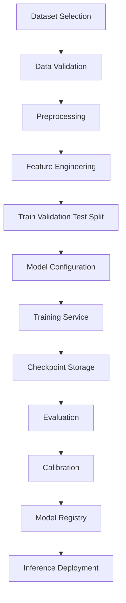

## 5.3 Training Configuration

Users can configure:

- Architecture.
- Number of layers.
- Hidden dimensions.
- Activation functions.
- Batch size.
- Learning rate.
- Optimizer.
- Weight decay.
- Dropout.
- Training duration.
- Validation strategy.
- Loss function.
- Early stopping.

Training metadata is recorded for reproducibility.

## 5.4 Model Evaluation

**Classification metrics**

- Accuracy.
- Precision.
- Recall.
- F1 score.
- Specificity.
- ROC-AUC.
- PR-AUC.
- Matthews correlation coefficient.

**Regression metrics**

- MAE.
- MSE.
- RMSE.
- R².
- Residual distribution.
- Prediction interval coverage.

**Scientific simulation metrics**

- Relative L2 error.
- Conservation residuals.
- Field reconstruction error.
- Parameter recovery error.
- Numerical stability.
- Generalization across physical conditions.

## 5.5 Physics-Informed Machine Learning

The PINN environment supports learning through data and physical constraints.

A configurable loss function:

\[
\mathcal L =
\lambda_d\mathcal L_{\text{data}}
+
\lambda_p\mathcal L_{\text{physics}}
+
\lambda_b\mathcal L_{\text{boundary}}
+
\lambda_i\mathcal L_{\text{initial}}
\]

Supported research problems include:

- Heat equations.
- Wave equations.
- Diffusion.
- Poisson equations.
- Selected fluid dynamics problems.
- Reduced plasma models.

## 5.6 Neural Operators

Prepare architectures for:

- Fourier Neural Operators.
- DeepONets.
- Graph Neural Operators.

Applications include:

- Physical field prediction.
- Simulation approximation.
- Parametric PDE modeling.
- Computational surrogate models.

Model performance is evaluated against numerical reference solutions.

## 5.7 Model Registry and MLOps

The model registry maintains:

- Architecture.
- Version.
- Training dataset.
- Configuration.
- Checkpoints.
- Evaluation metrics.
- Calibration information.
- Artifact references.
- Deployment status.

Model promotion requires appropriate evaluation and approval.

---

# 6. SCIENTIFIC DISCOVERY AND AUTOMATED RESEARCH

## 6.1 Scientific Discovery Intelligence

W.O.O.H.O.O. includes an automated scientific discovery environment.

Core features:

- Research question decomposition.
- AI hypothesis generation.
- Dataset discovery.
- Mathematical relationship identification.
- Symbolic regression.
- Causal inference.
- Experiment design.
- Anomaly investigation.
- Model comparison.
- Evidence evaluation.

## 6.2 Hypothesis Intelligence

Every generated hypothesis includes:

- Research question.
- Scientific domain.
- Proposed mechanism.
- Required observations.
- Relevant variables.
- Potential confounding factors.
- Suggested computational method.
- Falsification criteria.
- Alternative explanations.

Hypothesis statuses:

- Draft.
- Proposed.
- Under Investigation.
- Testing.
- Supported by Current Evidence.
- Not Supported.
- Contradicted.
- Inconclusive.

## 6.3 Equation Discovery

The Equation Discovery Lab integrates symbolic regression and differential equation identification.

Possible integrations:

- PySR.
- SINDy-compatible algorithms.
- Symbolic mathematical tools.

Workflow:

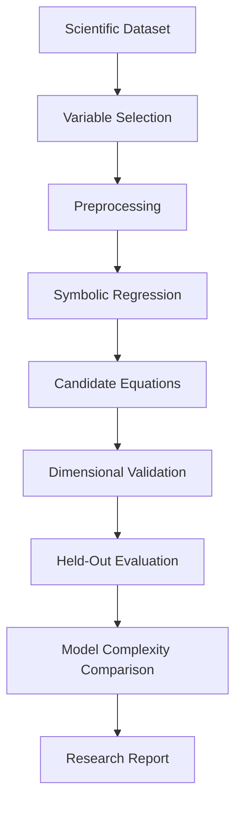

## 6.4 Causal Intelligence

Supports:

- Causal graph construction.
- Conditional independence.
- Confounder analysis.
- Structural causal models.
- Counterfactual evaluation.
- Sensitivity analysis.

Statistical correlations are not automatically interpreted as causal relationships.

## 6.5 Automated Experiment Design

Supported experimental methods:

- Factorial design.
- Latin hypercube sampling.
- Grid search.
- Bayesian experimental design.
- Parameter sensitivity studies.
- Sequential experiment selection.

The platform generates reproducible configurations and requires approval for expensive jobs.

## 6.6 Scientific Anomaly Detection

Support:

- Isolation Forest.
- Local Outlier Factor.
- Autoencoders.
- Variational Autoencoders.
- Temporal anomaly models.
- Physics residual analysis.

Detected anomalies are treated as research candidates requiring examination, not automatic discoveries.

---

# 7. ASTROPHYSICS AND EXOPLANET INTELLIGENCE

## 7.1 Exoplanet Hunter AI

Exoplanet Hunter is a flagship research application.

Its purpose is to analyze stellar observations and identify possible planetary transit signatures.

Features:

- Light-curve ingestion.
- Data preprocessing.
- Signal analysis.
- Box Least Squares integration.
- Periodogram analysis.
- Transit candidate detection.
- CNN classification.
- Temporal Transformer workflows.
- Candidate ranking.
- Uncertainty estimation.

## 7.2 Transit Analysis

The application analyzes:

- Observation timestamps.
- Normalized flux.
- Transit depth.
- Transit duration.
- Orbital period.
- Signal significance.
- Data quality.

It supports synchronized visualization between simulated planetary motion and associated stellar light curves.

## 7.3 Candidate Profiles

Each candidate profile includes:

- Identifier.
- Host star.
- Orbital period estimate.
- Planet radius estimate where supported.
- Transit duration.
- Model version.
- Supporting observations.
- Prediction uncertainty.

Candidates are not automatically represented as confirmed planets.

## 7.4 GravityLens AI

A computer vision system for analyzing gravitational lensing candidates.

Capabilities:

- Einstein ring classification.
- Gravitational arc detection.
- Segmentation.
- Image preprocessing.
- Vision Transformers.
- CNNs.
- U-Net-style models.
- Confidence visualization.

## 7.5 Black Hole Intelligence

Features:

- Schwarzschild radius calculations.
- Rotating black hole parameter exploration.
- Accretion disk visualization.
- Relativistic lensing representations.
- Ray-tracing integration interfaces.
- Scientific parameter comparison.

## 7.6 Gravitational Wave Intelligence

Supports:

- Waveform ingestion.
- Time-domain analysis.
- Frequency-domain analysis.
- Spectrograms.
- Signal classification.
- Denoising.
- Event parameter estimation interfaces.
- Anomaly detection.

## 7.7 Solar Intelligence

Supports:

- Solar image analysis.
- Active region classification.
- Solar observation processing.
- Time-series forecasting.
- Magnetic field data exploration.
- Space weather dataset integration.

## 7.8 Virtual Observatory

The Virtual Observatory supports:

- Celestial sky exploration.
- Astronomical object search.
- Target discovery.
- Observation planning.
- Telescope profile modeling.
- Synthetic observation generation.
- Observation visibility calculations.
- Scheduling optimization.
- Space mission simulation.
- Satellite data exploration.

The platform is a research planning and simulation environment, not an unrestricted controller for physical telescopes or spacecraft.

---

# 8. COSMOLOGY AND DARK MATTER INTELLIGENCE

## 8.1 Cosmology Intelligence Lab

The Cosmology Intelligence environment investigates large-scale cosmic structure, cosmological models and universe simulations.

Capabilities:

- Galaxy clustering.
- Cosmic web analysis.
- Density field reconstruction.
- Dark matter modeling.
- Dark energy exploration.
- Galaxy population analysis.
- Cosmological parameter estimation.
- CMB data analysis.
- N-body simulation analysis.

## 8.2 Cosmic Web Intelligence

Support classification of:

- Filaments.
- Voids.
- Galaxy clusters.
- Sheets.
- Density structures.

Model architectures include:

- 3D CNNs.
- GNNs.
- Point-cloud networks.
- Volumetric neural networks.
- Autoencoders.

## 8.3 Dark Matter Intelligence

Supports:

- Density field reconstruction.
- Halo identification.
- Density profile comparison.
- Gravitational potential modeling.
- Lensing connections.
- N-body simulation analysis.

## 8.4 Cosmological Expansion

Support configurable cosmological models.

Include:

- Lambda-CDM.
- Flat Lambda-CDM.
- Curved Lambda-CDM.
- wCDM.
- Selected extended models.

Explore:

- Hubble parameter.
- Scale factor.
- Redshift.
- Comoving distance.
- Luminosity distance.
- Angular diameter distance.
- Lookback time.

For example, the Hubble expansion relation is represented by:

\[
H(z)=H_0E(z)
\]

The function \(E(z)\) depends on the selected cosmological model and its parameters.

## 8.5 Cosmic Microwave Background Intelligence

Supports:

- CMB map visualization.
- HEALPix-compatible data.
- Temperature map analysis.
- Power spectrum exploration.
- Spherical harmonics.
- Cosmological likelihood integration.
- Bayesian parameter inference.

## 8.6 Cosmological Neural Models

Support:

- Cosmic field prediction.
- Neural surrogate simulations.
- Galaxy classification.
- Cosmic structure identification.
- Graph-based modeling.
- Uncertainty estimation.

Integration interfaces include established cosmological computation tools such as CLASS and CAMB.

---

# 9. QUANTUM COMPUTING AND QUANTUM MACHINE LEARNING

## 9.1 Quantum Intelligence Center

The Quantum Intelligence Center supports quantum computing experimentation and quantum mechanics simulation.

Capabilities:

- Quantum state simulation.
- Statevector computation.
- Density matrix computation.
- Quantum circuit design.
- Gate operations.
- Measurement.
- Entanglement analysis.
- Quantum algorithms.
- Quantum machine learning.
- Quantum noise.
- Many-body physics.

## 9.2 Quantum State Analysis

Support:

- State normalization.
- Complex amplitudes.
- Density matrices.
- Partial trace.
- Quantum fidelity.
- Trace distance.
- Purity.
- Von Neumann entropy.
- Entanglement measures for appropriate systems.

## 9.3 Quantum Circuit Studio

Gate library:

- Pauli gates.
- Hadamard.
- Phase gates.
- Rotation gates.
- CNOT.
- Controlled-Z.
- SWAP.
- Toffoli.
- Measurement.

Features:

- Circuit editor.
- Parameterized gates.
- Circuit compilation.
- Gate optimization.
- Depth analysis.
- Backend compatibility.

## 9.4 Quantum Algorithm Lab

Includes:

- Quantum Fourier Transform.
- Quantum Phase Estimation.
- Grover's algorithm.
- Variational Quantum Eigensolver.
- Quantum Approximate Optimization Algorithm.
- Educational error correction demonstrations.

## 9.5 Quantum Machine Learning

Support:

- Variational quantum classifiers.
- Quantum kernels.
- Quantum neural networks.
- Hybrid classical-quantum architectures.

Compare quantum simulation results against suitable classical baselines.

## 9.6 Quantum Many-Body Physics

Support:

- Hamiltonian construction.
- Spin systems.
- Small lattice systems.
- Exact diagonalization.
- State evolution.
- Open quantum systems.
- Noise channels.
- Tensor network integration.

## 9.7 Quantum Backend Interfaces

Prepare compatible adapters for:

- Qiskit.
- Cirq.
- PennyLane.
- QuTiP.
- Stim.
- Supported tensor network libraries.

Distinguish local simulation from actual quantum hardware execution.

---

# 10. PARTICLE PHYSICS INTELLIGENCE

## 10.1 Particle Physics Intelligence Center

Supports scientific analysis of high-energy physics datasets and detector event records.

Core capabilities:

- Particle event ingestion.
- Event reconstruction.
- Particle classification.
- Detector modeling.
- Track reconstruction.
- Jet classification.
- Neutrino research.
- Monte Carlo analysis.
- Anomaly detection.
- Statistical model comparison.

## 10.2 Scientific Data Integrations

Prepare connectors for appropriate public resources:

- CERN Open Data.
- ATLAS public datasets.
- CMS public datasets.
- LHCb public data where accessible.
- Other suitable particle physics benchmarks.

Support ROOT-based scientific workflows.

Relevant processing libraries include:

- Uproot.
- Awkward Array.
- Vector.
- Coffea.

## 10.3 Detector Intelligence

Create interactive 3D detector environments.

Display:

- Tracking layers.
- Detector geometry.
- Particle trajectories.
- Interaction vertices.
- Calorimeter measurements.
- Energy deposits.
- Reconstructed objects.

## 10.4 Graph Neural Network Track Reconstruction

Represent detector measurements as graph nodes and candidate relationships as edges.

Support:

- Edge classification.
- Hit association.
- Track construction.
- Track evaluation.
- Reconstruction uncertainty.

## 10.5 Particle Classification

Support suitable model architectures for:

- Particle candidate classification.
- Jet classification.
- Event categorization.
- Representation learning.

Use available ground-truth labels and documented datasets.

## 10.6 Neutrino Intelligence

Prepare analysis workflows for appropriate public neutrino research datasets.

Support event metadata, measurement inspection, event classification and anomaly analysis.

## 10.7 Theoretical Particle Physics

Provide:

- Standard Model knowledge explorer.
- Particle property references.
- Interaction diagrams.
- Conservation law calculations.
- Mathematical expression tools.
- Feynman diagram editor.

Distinguish educational models from complete field-theory calculations.

---

# 11. MATERIALS SCIENCE AND ATOMIC SIMULATION

## 11.1 Materials Intelligence Center

A computational research environment for materials science and condensed matter physics.

Capabilities:

- Atomic structure analysis.
- Crystal visualization.
- Material property prediction.
- Crystal graph generation.
- Density Functional Theory integration.
- Molecular dynamics.
- Neural interatomic potentials.
- Electronic structure.
- Thermodynamic analysis.
- Generative materials discovery.

## 11.2 Atomic Structure Explorer

Support:

- CIF.
- POSCAR.
- XYZ.
- Extended XYZ.
- Appropriate molecular formats.

Use scientific structure-processing libraries such as ASE and pymatgen.

## 11.3 Crystal Graph Neural Networks

Represent:

- Atomic species as graph nodes.
- Neighbor relationships as graph edges.
- Interatomic geometry as graph attributes.

Support:

- Message passing.
- Graph convolution.
- Graph attention.
- Equivariant networks.
- SchNet-style architectures.
- M3GNet-compatible models.

## 11.4 Material Property Prediction

Estimate supported properties such as:

- Formation energy.
- Energy above hull.
- Band gap.
- Density.
- Elastic properties.
- Magnetic properties.

Display prediction uncertainty and model domain.

## 11.5 DFT Integration

Prepare integration interfaces for:

- Quantum ESPRESSO.
- ABINIT.
- GPAW.
- CP2K.
- VASP where properly licensed.

Support:

- Structural relaxation.
- Total energy.
- Electronic structure.
- Density of states.
- Charge density.
- Magnetic properties.

## 11.6 Molecular Dynamics

Integrate suitable engines and data formats.

Support:

- Atomic trajectories.
- Energy.
- Temperature.
- Pressure where available.
- Radial distribution functions.
- Mean squared displacement.

## 11.7 Neural Interatomic Potentials

Prepare integrations for:

- MACE.
- NequIP.
- Allegro.
- CHGNet.
- M3GNet.

Compare model predictions against appropriate reference calculations.

## 11.8 Generative Materials Discovery

Support generative structure candidates, inverse property optimization, structural validation and active learning.

Generated structures must be distinguished from synthesized or experimentally verified materials.

---

# 12. PLASMA PHYSICS AND FUSION RESEARCH

## 12.1 Plasma Intelligence Center

A dedicated scientific environment for computational plasma physics and fusion research.

Capabilities:

- Magnetohydrodynamics.
- Plasma state modeling.
- Electromagnetic fields.
- Plasma waves.
- Turbulence.
- Energy transport.
- Physics-informed learning.
- Neural plasma surrogates.
- Plasma anomaly detection.
- Plasma digital twins.

## 12.2 MHD Simulation

Support suitable implementations of:

- Mass conservation.
- Momentum equations.
- Magnetic induction.
- Magnetic divergence constraints.
- Ideal and selected non-ideal MHD.

## 12.3 Plasma State Analysis

Calculate supported physical properties:

- Electron density.
- Ion density.
- Electron temperature.
- Ion temperature.
- Plasma frequency.
- Debye length.
- Plasma beta.

Validate units and assumptions.

## 12.4 Plasma Turbulence Intelligence

Support:

- Fourier analysis.
- Power spectral density.
- Wavelet analysis.
- Fluctuation statistics.
- Temporal Transformers.
- CNNs.
- Autoencoders.

## 12.5 Neural Plasma Models

Include:

- PINNs.
- Fourier Neural Operators.
- DeepONets.
- Graph Neural Networks.
- Neural state-space models.

Evaluate physical residuals and field prediction errors.

## 12.6 Fusion Research

Provide educational and computational modeling workflows involving magnetic confinement, plasma states, energy balance and transport models.

Clearly distinguish research simulations from actual fusion facility measurements or operational controls.

## 12.7 Plasma Digital Twins

Combine numerical physical representations with validated machine learning models.

Support calibration, prediction, state monitoring and uncertainty evaluation.

---

# 13. COMPUTATIONAL PHYSICS AND NUMERICAL SIMULATION

## 13.1 Physics Simulation Studio

A unified computational physics laboratory.

Supported domains:

- Classical mechanics.
- Orbital mechanics.
- Electromagnetism.
- Thermodynamics.
- Fluid dynamics.
- Wave mechanics.
- Plasma physics.
- Quantum mechanics.

## 13.2 Numerical Solver Infrastructure

Support suitable:

- Euler methods.
- Runge-Kutta methods.
- Adaptive integration.
- Symplectic methods.
- Implicit numerical methods.
- ODE solvers.
- PDE solver integrations.

Use established scientific numerical packages.

## 13.3 Physical Equations

Provide reusable equation definitions.

Newton's second law:

\[
F=ma
\]

Gravitational force:

\[
F=G\frac{m_1m_2}{r^2}
\]

Circular orbital velocity:

\[
v=\sqrt{\frac{GM}{r}}
\]

Schwarzschild radius:

\[
r_s=\frac{2GM}{c^2}
\]

Heat equation:

\[
\frac{\partial u}{\partial t}
=\alpha\nabla^2u
\]

Wave equation:

\[
\frac{\partial^2u}{\partial t^2}
=c^2\nabla^2u
\]

## 13.4 Inverse Physics

Estimate physical parameters from observations.

Support:

- Nonlinear least squares.
- Bayesian estimation.
- Gradient-based optimization.
- Differentiable simulation.
- Sensitivity analysis.

## 13.5 Physics Digital Twins

Create reusable computational representations of physical systems.

Track:

- Physical parameters.
- Equations.
- Initial conditions.
- Boundary conditions.
- Numerical settings.
- ML approximations.
- Calibration history.
- Uncertainty.

## 13.6 Neural Surrogate Models

Train models to approximate computationally expensive simulations.

Compare against numerical reference solutions.

Evaluate speed and accuracy together.

## 13.7 Physics-Aware Optimization

Support:

- Bayesian optimization.
- Grid search.
- Random search.
- Evolutionary methods.
- Differential evolution.
- Gradient optimization.

Include physical and numerical constraints.

---

# 14. ADVANCED 3D VISUALIZATION ENGINE

## 14.1 Unified Scientific Renderer

W.O.O.H.O.O. includes a shared 3D visualization infrastructure.

Technologies:

- Three.js.
- React Three Fiber.
- Drei.
- WebGL.
- WebGPU where supported.
- GLSL shaders.

The same rendering infrastructure powers all major research modules.

## 14.2 Rendering Architecture

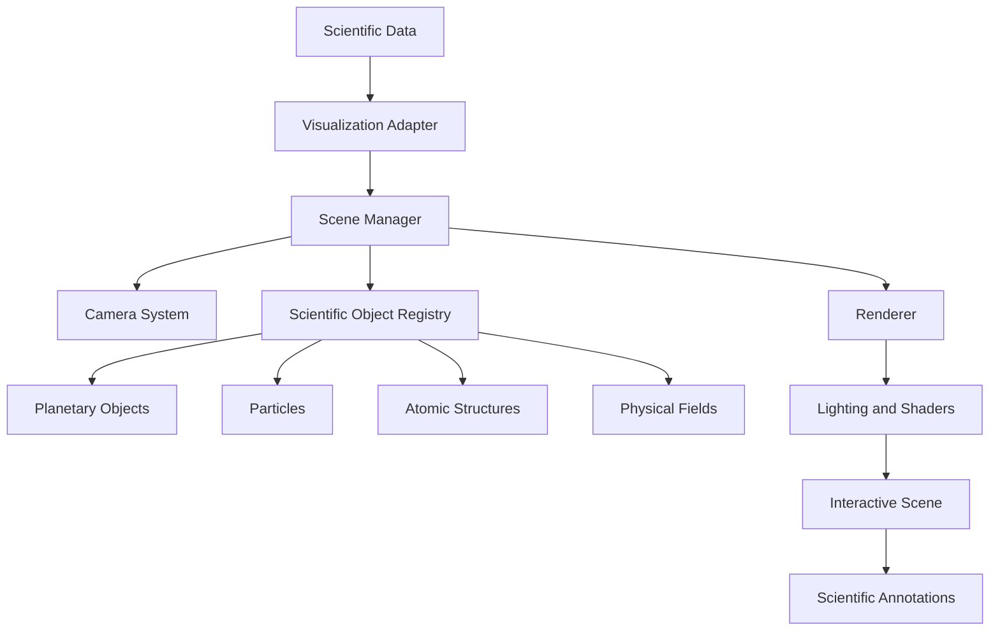

## 14.3 Scientific Environments

Support:

- Planetary systems.
- Exoplanet transits.
- Black holes.
- Gravitational lensing.
- Cosmic web.
- Galaxy clusters.
- Quantum states.
- Quantum circuits.
- Particle detectors.
- Atomic structures.
- Molecular dynamics.
- Plasma fields.
- Fluid dynamics.

## 14.4 Scientific Rendering Components

Create reusable:

- CelestialBody.
- StarRenderer.
- PlanetAtmosphere.
- OrbitPath.
- ParticleSystem.
- FieldVectorRenderer.
- VolumeRenderer.
- CrystalStructureRenderer.
- DetectorGeometry.
- QuantumBlochSphere.
- MolecularTrajectory.
- ScientificAnnotation.

## 14.5 Advanced Visualization

Include:

- Camera presets.
- Object selection.
- Raycasting.
- Particle instancing.
- Density visualization.
- Volumetric rendering.
- Scientific labels.
- Vector fields.
- Isosurfaces.
- Timelines.
- Scientific coordinate systems.

## 14.6 Performance Optimization

Implement:

- Instanced rendering.
- Geometry reuse.
- Frustum culling.
- Level of detail.
- Progressive loading.
- Efficient texture management.
- GPU rendering where suitable.
- Memory cleanup.
- Mobile rendering profiles.

## 14.7 Scientific Transparency

Each visualization should identify whether its content represents:

- Real observations.
- Numerical simulations.
- Mathematical calculations.
- Machine learning predictions.
- Synthetic demonstrations.
- Conceptual illustrations.

Visual scaling and cosmetic shader effects must never be confused with measured physical quantities.

---

# 15. VIRTUAL OBSERVATORY AND SPACE MISSION INTELLIGENCE

## 15.1 Virtual Observatory

Supports:

- Celestial sky maps.
- Astronomical target search.
- Object metadata.
- Catalog integrations.
- Observation planning.
- Visibility calculations.
- Telescope configuration.
- Instrument modeling.
- Synthetic observations.
- Observation scheduling.

## 15.2 Astronomical Sources

Prepare documented connector integrations with:

- NASA Exoplanet Archive.
- MAST.
- Gaia Archive.
- VizieR.
- SIMBAD.
- NASA/IPAC archives.
- NOIRLab archive.
- Public heliophysics sources.

## 15.3 Telescope and Instrument Modeling

Represent:

- Aperture.
- Focal length.
- Detector properties.
- Pixel scale.
- Exposure.
- Noise assumptions.
- Instrument compatibility.

Generate synthetic observations using documented assumptions.

## 15.4 Space Mission Intelligence

Support:

- Orbital propagation.
- Two-body modeling.
- Selected perturbation models.
- Orbital transfers.
- Trajectory comparisons.
- Mission timelines.
- Spacecraft visualization.

## 15.5 Satellite Data

Prepare integrations for appropriate publicly accessible orbital data.

Support:

- TLE processing.
- SGP4-compatible propagation.
- Ground tracks.
- Orbital parameters.
- Epoch tracking.

Always document data age and propagation limitations.

## 15.6 Observation Scheduling

Support:

- Visibility constraints.
- Target prioritization.
- Instrument availability.
- Time windows.
- Scheduling optimization.
- Calendar visualization.

The platform operates as a planning and simulation environment, not an unrestricted controller for physical equipment.

---

# 16. SCIENTIFIC DATA INTELLIGENCE INFRASTRUCTURE

## 16.1 Scientific Data Intelligence Center

Centralized management for heterogeneous scientific datasets.

Support:

- Astronomy data.
- Particle physics data.
- Cosmology data.
- Materials datasets.
- Plasma observations.
- Simulation outputs.
- Quantum experiment records.

## 16.2 Data Lake Architecture

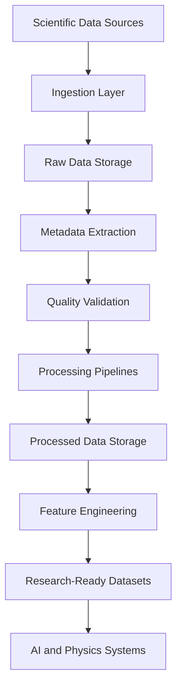

## 16.3 Supported Formats

- FITS.
- ROOT.
- CSV.
- JSON.
- Parquet.
- HDF5.
- NetCDF.
- Zarr.
- CIF.
- XYZ.
- Other supported scientific formats.

Use format-specific processing libraries.

## 16.4 Scientific Dataset Connectors

Integrate appropriate public scientific repositories.

Examples include:

- NASA Exoplanet Archive.
- MAST.
- ESA Gaia Archive.
- CERN Open Data.
- Materials Project.
- NOMAD.
- Public gravitational-wave datasets.
- Public plasma research datasets.

## 16.5 Dataset Quality

Inspect:

- Missing values.
- Invalid records.
- Units.
- Coordinate systems.
- Duplicate observations.
- Timestamp consistency.
- Schema changes.
- Measurement uncertainty.
- Data licensing.

## 16.6 Astronomical Cross-Matching

Support:

- Coordinate matching.
- Angular separation.
- Proper motion.
- Epoch transformation.
- Catalog comparison.
- Probabilistic matching.

## 16.7 Data Provenance

Maintain source-to-prediction lineage.

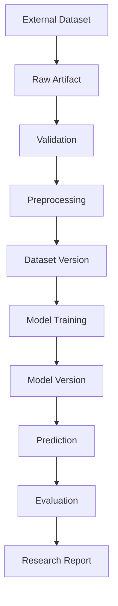

Every stage must be traceable.

---

# 17. MULTI-AGENT SCIENTIFIC RESEARCH

## 17.1 Scientific Agent Architecture

W.O.O.H.O.O. includes an extensible agent environment for coordinating research workflows.

Specialized agents include:

- Research Coordinator.
- Astrophysics Agent.
- Cosmology Agent.
- Quantum Physics Agent.
- Particle Physics Agent.
- Materials Science Agent.
- Plasma Physics Agent.
- Mathematics Agent.
- Machine Learning Architect.
- Dataset Intelligence Agent.
- Numerical Simulation Agent.
- Model Evaluation Agent.
- Literature Research Agent.
- Report Generation Agent.

## 17.2 Hierarchical Orchestration

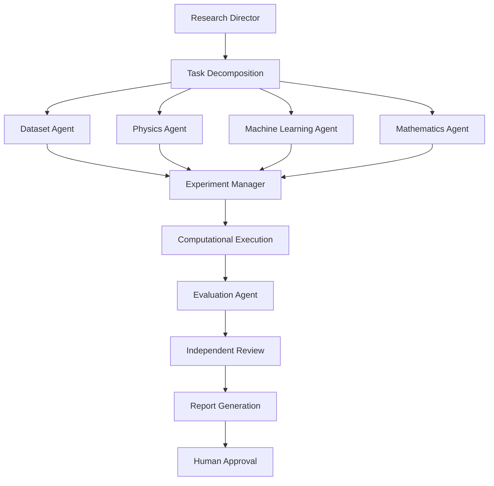

## 17.3 Agent Capabilities

Agents can:

- Retrieve authorized datasets.
- Inspect schemas.
- Suggest physical equations.
- Generate experiment configurations.
- Run approved tools.
- Review numerical outputs.
- Evaluate models.
- Search connected scientific references.
- Generate research reports.

## 17.4 Workflow Management

Support:

- Sequential execution.
- Parallel execution.
- Task dependencies.
- Cancellation.
- Retry.
- Logging.
- Failure recovery.
- Human approval.

## 17.5 Research Memory

Maintain workspace-specific research context:

- Objectives.
- Datasets.
- Experiments.
- Models.
- Notes.
- References.
- Reports.
- Approved conclusions.

Never mix private records between workspaces.

---

# 18. DATABASE ARCHITECTURE

## 18.1 Database Strategy

Use PostgreSQL as the central relational data store.

Use object storage for larger scientific artifacts.

Use pgvector or an equivalent vector indexing system for suitable semantic retrieval workflows.

The exact schema is modular and shared across application domains.

## 18.2 Core Entities

| Table or entity | Purpose |
|---|---|
| profiles | User profiles |
| workspaces | Research workspaces |
| datasets | Scientific datasets |
| dataset_versions | Dataset version control |
| scientific_data_sources | External data connections |
| experiments | Research experiments |
| experiment_metrics | Evaluation measurements |
| model_registry | ML models |
| model_versions | Versioned model artifacts |
| training_runs | Training execution |
| simulation_runs | Physics computations |
| simulation_metrics | Numerical diagnostics |
| physics_models | Governing physical models |
| research_investigations | Discovery projects |
| research_hypotheses | Scientific hypotheses |
| hypothesis_evidence | Evidence records |
| scientific_knowledge | Research documents |
| agent_workflows | Agent orchestration |
| agent_execution_logs | Agent execution history |
| quantum_circuits | Quantum circuit definitions |
| quantum_states | Quantum state records |
| quantum_experiments | Quantum experiments |
| cosmological_models | Cosmological configurations |
| material_records | Materials information |
| atomic_structures | Crystal and molecular structures |
| plasma_models | Plasma computational models |
| particle_events | Particle physics records |
| observatories | Observatory configurations |
| observation_plans | Research observation plans |

## 18.3 Data Ownership

All user-owned entities should be associated with a workspace.

Row-level security should ensure authorized access.

Apply appropriate policies to:

- Datasets.
- Experiments.
- Models.
- Research projects.
- Simulation artifacts.
- Documents.
- Reports.

## 18.4 Database Design Principles

Use:

- Foreign keys.
- Unique constraints.
- Appropriate indexes.
- Versioned artifacts.
- JSONB for flexible metadata.
- Explicit units.
- Timestamp consistency.
- Audit history.

Avoid storing large binary scientific files directly in ordinary relational records.

Store artifact references instead.

---

# 19. API ARCHITECTURE

## 19.1 API Design

The backend exposes versioned APIs through FastAPI.

Core route organization:

```text
/api/v1/
    auth/
    users/
    workspaces/
    ai/
    models/
    datasets/
    experiments/
    discovery/
    astronomy/
    exoplanets/
    cosmology/
    quantum/
    particles/
    materials/
    plasma/
    physics/
    simulations/
    observatory/
    mission/
    reports/
```

## 19.2 Scientific AI API

Example endpoints:

```http
POST /api/v1/ai/classify-task
POST /api/v1/ai/reason
POST /api/v1/ai/multimodal-analysis
POST /api/v1/ai/predict
POST /api/v1/ai/evaluate-prediction
POST /api/v1/ai/research-workflow
GET  /api/v1/ai/models
```

## 19.3 Experiment API

```http
POST /api/v1/experiments
GET  /api/v1/experiments
GET  /api/v1/experiments/{id}
POST /api/v1/experiments/{id}/run
POST /api/v1/experiments/{id}/cancel
GET  /api/v1/experiments/{id}/metrics
```

## 19.4 Dataset API

```http
POST /api/v1/data/ingestion
GET  /api/v1/data/datasets
GET  /api/v1/data/datasets/{id}
POST /api/v1/data/validate
POST /api/v1/data/search
POST /api/v1/data/catalog/crossmatch
GET  /api/v1/data/lineage/{datasetId}
```

## 19.5 Physics API

```http
POST /api/v1/physics/models
POST /api/v1/physics/simulations
POST /api/v1/physics/simulations/{id}/run
POST /api/v1/physics/surrogates/train
POST /api/v1/physics/inverse/estimate
POST /api/v1/physics/optimization/run
GET  /api/v1/physics/jobs/{id}
```

## 19.6 API Standards

Use:

- Typed request schemas.
- Typed response schemas.
- Input validation.
- Authentication.
- Authorization.
- Rate limiting.
- Request identifiers.
- Structured error messages.
- API versioning.

Long-running operations should execute asynchronously.

---

# 20. SECURITY AND SCIENTIFIC INTEGRITY

## 20.1 Authentication and Authorization

Implement secure authentication.

Enforce workspace-level access controls.

Use row-level security for relevant records.

## 20.2 Secrets Management

Store:

- AI provider credentials.
- Scientific data credentials.
- Quantum hardware credentials.
- Storage credentials.
- External service credentials.

On the backend or in an approved secrets manager.

Never expose secrets through frontend bundles or public GitHub files.

## 20.3 Computational Resource Controls

Implement:

- Job quotas.
- Maximum execution times.
- Memory limits.
- GPU resource checks.
- File size restrictions.
- Background job cancellation.
- Controlled retries.

Prevent uncontrolled computational allocation.

## 20.4 Scientific Data Integrity

Clearly distinguish:

| Data category | Description |
|---|---|
| Observational | Actual retrieved scientific observations |
| Experimental | Published or supplied experimental measurements |
| Numerical | Outputs from computational solvers |
| Predictive | Machine learning outputs |
| Synthetic | Artificially generated demonstration data |
| Conceptual | Educational and illustrative models |

## 20.5 AI Reliability

The platform should never:

- Invent source citations.
- Fabricate scientific observations.
- Claim a simulation executed when it did not.
- Report fabricated model performance.
- Present predictions as established measurements.
- Interpret correlation as automatic proof of causation.
- Hide uncertainty.
- Claim a new scientific discovery based only on an anomaly score.

Every research conclusion should be traceable to available evidence.

---

# 21. INSTALLATION AND CONFIGURATION

## 21.1 Prerequisites

Recommended development environment:

- Node.js.
- npm or an equivalent package manager.
- Python 3.
- Git.
- PostgreSQL or Supabase.
- Access to configured scientific compute services.
- Docker for containerized deployments where used.

Additional resources may be needed for specific numerical simulations, GPU training and scientific file processing.

## 21.2 Clone the Repository

```bash
git clone https://github.com/YOUR_USERNAME/woohoo-discovery-engine.git

cd woohoo-discovery-engine
```

Replace the repository URL with the actual project URL.

## 21.3 Frontend Installation

```bash
npm install
```

Start the development environment:

```bash
npm run dev
```

Build the production frontend:

```bash
npm run build
```

Run code quality checks:

```bash
npm run lint
```

## 21.4 Python Backend Setup

Create a virtual environment:

```bash
python -m venv .venv
```

Activate it.

macOS/Linux:

```bash
source .venv/bin/activate
```

Windows:

```powershell
.venv\Scripts\activate
```

Install backend dependencies:

```bash
pip install -r backend/requirements.txt
```

Start the FastAPI service:

```bash
uvicorn backend.main:app --reload --port 8000
```

API documentation:

```text
http://localhost:8000/docs
```

Adjust the module path to match the actual backend entry point.

## 21.5 Environment Configuration

Create a local environment file.

Example:

```env
# Application
APP_NAME=WOOHOO_DISCOVERY_ENGINE
APP_ENV=development
APP_VERSION=1.0.0

# Frontend
VITE_API_BASE_URL=http://localhost:8000/api/v1

# Backend
API_HOST=0.0.0.0
API_PORT=8000

# Database
DATABASE_URL=your_database_connection

# Supabase
SUPABASE_URL=your_supabase_url
SUPABASE_ANON_KEY=your_public_anon_key
SUPABASE_SERVICE_ROLE_KEY=your_private_service_role_key

# Storage
OBJECT_STORAGE_ENDPOINT=
OBJECT_STORAGE_BUCKET=

# AI Providers
OPENAI_API_KEY=
ANTHROPIC_API_KEY=

# Research Data
NASA_API_KEY=
CERN_DATA_ENDPOINT=

# Scientific Compute
COMPUTE_WORKER_ENABLED=true
MAX_CONCURRENT_JOBS=2

# Quantum Integrations
QUANTUM_BACKEND_PROVIDER=
QUANTUM_BACKEND_API_KEY=

# Monitoring
LOG_LEVEL=INFO
```

Only populate the credentials for services actually configured.

Use deployment secrets for production credentials.

Never commit real `.env` files to GitHub.

## 21.6 Database Setup

Apply the existing database migration system.

```bash
supabase migration list
```

Run the applicable migrations through the project's configured Supabase workflow.

Verify:

- Database connectivity.
- Row-level security.
- Workspace isolation.
- Storage permissions.
- Foreign key integrity.
- Index availability.

Do not assume that frontend environment configuration alone secures backend operations.

## 21.7 Demo Mode

The application provides an explicitly labeled demo environment.

Demonstration capabilities may include:

- Synthetic stellar light curves.
- Example planetary systems.
- Sample particle events.
- Example quantum circuits.
- Synthetic atomic structures.
- Demonstration plasma fields.
- Example cosmological density volumes.
- Sample simulation histories.

Demo mode should allow users to explore the application without external API credentials.

Clearly distinguish demonstration outputs from actual observations and completed scientific computations.

---

# 22. TESTING AND EVALUATION

## 22.1 Testing Strategy

W.O.O.H.O.O. uses multiple testing layers.

**Frontend testing**
- Component tests.
- Navigation.
- Form validation.
- Chart interactions.
- Scene lifecycle.
- Responsive layouts.

**Backend testing**
- API validation.
- Authentication.
- Database access.
- Job management.
- File processing.

**Machine learning testing**
- Input schema.
- Model inference.
- Training reproducibility.
- Calibration.
- Generalization.
- Error analysis.

**Scientific testing**
- Unit conversion.
- Mathematical formulas.
- Numerical solver comparison.
- Physical constraints.
- Reference calculations.

## 22.2 Scientific Reference Tests

Use documented reference problems.

Examples include:

- Two-body orbital motion.
- Harmonic oscillator.
- One-dimensional heat equation.
- Simple wave equation.
- Quantum state normalization.
- Bell-state preparation.
- Exact diagonalization of small Hamiltonians.
- Known crystal structure parsing.
- Dimensional consistency tests.

## 22.3 ML Evaluation

Track:

- Training/validation separation.
- Test performance.
- Calibration.
- Out-of-distribution behavior.
- Prediction uncertainty.
- Model complexity.
- Inference latency.

Avoid information leakage between training and testing.

## 22.4 Visualization Testing

Test:

- Scene initialization.
- Camera controls.
- Object selection.
- Scientific annotation.
- Numerical state synchronization.
- Resource disposal.
- WebGL compatibility.
- Responsive behavior.

## 22.5 Reproducibility

Store configurations required to recreate experiments.

Include:

- Model version.
- Data version.
- Random seed where applicable.
- Numerical tolerances.
- Software environment.
- Input parameters.
- Reference method.

---

# 23. DEPLOYMENT AND INFRASTRUCTURE

## 23.1 Deployment Architecture

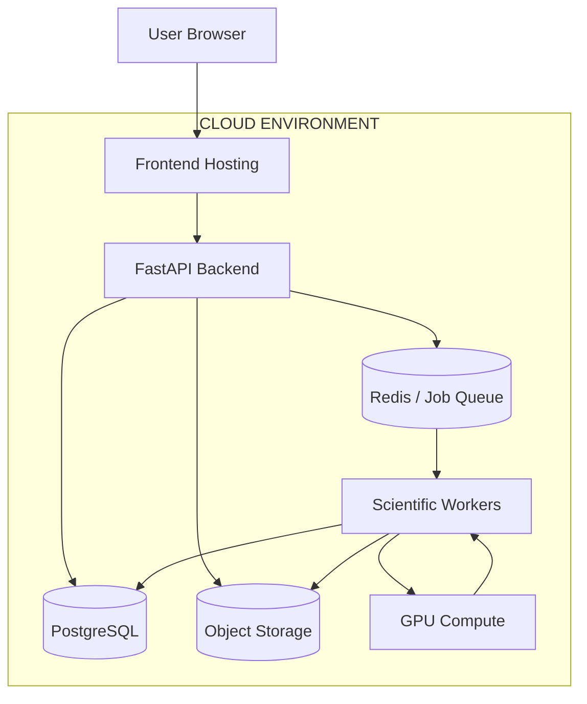

## 23.2 Hosting Strategy

Recommended deployment separation:

| Component | Suggested infrastructure |
|---|---|
| Frontend | Static or edge hosting |
| Backend APIs | Containerized application hosting |
| Database | Managed PostgreSQL |
| Scientific files | Object storage |
| Job queue | Redis or equivalent |
| ML inference | CPU/GPU workers |
| Large simulations | Dedicated computational workers |
| Monitoring | Centralized logs and metrics |

## 23.3 Containerization

For deployments using Docker, define separate services for:

- Frontend.
- Backend API.
- Worker.
- Database or external database connection.
- Redis.
- Optional ML inference service.

Keep GPU-specific containers separate where required.

## 23.4 Background Job Management

Every computational job should support:

- Unique job ID.
- Execution state.
- Logs.
- Resource requirements.
- Progress updates.
- Output references.
- Failure messages.
- Cancellation.

## 23.5 Monitoring

Monitor:

- API latency.
- Request errors.
- Database availability.
- Worker health.
- GPU availability.
- Queue length.
- Simulation execution.
- AI service availability.
- Storage utilization.

Do not expose sensitive data in unrestricted logs.

## 23.6 Backup and Recovery

Maintain appropriate backups for:

- Database records.
- Research workspaces.
- Model metadata.
- Simulation configurations.
- Dataset metadata.
- Scientific reports.

Large artifact backups should use suitable object storage versioning and lifecycle policies.

---

# 24. PROJECT STRUCTURE

## 24.1 Recommended Monorepo Structure

```text
woohoo-discovery-engine/
│
├── frontend/
│   ├── public/
│   │
│   ├── src/
│   │   ├── components/
│   │   │   ├── layout/
│   │   │   ├── dashboard/
│   │   │   ├── scientific/
│   │   │   ├── datasets/
│   │   │   ├── charts/
│   │   │   ├── visualization/
│   │   │   ├── experiments/
│   │   │   └── agents/
│   │   │
│   │   ├── modules/
│   │   │   ├── discovery/
│   │   │   ├── exoplanets/
│   │   │   ├── astronomy/
│   │   │   ├── cosmology/
│   │   │   ├── quantum/
│   │   │   ├── particles/
│   │   │   ├── materials/
│   │   │   ├── plasma/
│   │   │   ├── physics/
│   │   │   ├── observatory/
│   │   │   └── research/
│   │   │
│   │   ├── scenes/
│   │   │   ├── stars/
│   │   │   ├── planets/
│   │   │   ├── orbits/
│   │   │   ├── blackholes/
│   │   │   ├── galaxies/
│   │   │   ├── cosmic-web/
│   │   │   ├── quantum/
│   │   │   ├── particles/
│   │   │   ├── atoms/
│   │   │   └── plasma/
│   │   │
│   │   ├── services/
│   │   ├── hooks/
│   │   ├── types/
│   │   ├── utils/
│   │   └── lib/
│   │
│   └── package.json
│
├── backend/
│   ├── api/
│   │   ├── routes/
│   │   ├── schemas/
│   │   └── middleware/
│   │
│   ├── ai/
│   │   ├── orchestration/
│   │   ├── models/
│   │   ├── multimodal/
│   │   ├── evaluation/
│   │   ├── agents/
│   │   └── rag/
│   │
│   ├── science/
│   │   ├── astronomy/
│   │   ├── cosmology/
│   │   ├── quantum/
│   │   ├── particles/
│   │   ├── materials/
│   │   ├── plasma/
│   │   └── physics/
│   │
│   ├── simulation/
│   │   ├── orbital/
│   │   ├── mhd/
│   │   ├── fluid/
│   │   ├── quantum/
│   │   └── cosmology/
│   │
│   ├── data/
│   │   ├── connectors/
│   │   ├── ingestion/
│   │   ├── preprocessing/
│   │   ├── validation/
│   │   └── lineage/
│   │
│   ├── workers/
│   ├── services/
│   ├── models/
│   ├── database/
│   ├── tests/
│   └── main.py
│
├── supabase/
│   ├── migrations/
│   ├── functions/
│   └── seed.sql
│
├── infrastructure/
│   ├── docker/
│   ├── deployment/
│   ├── monitoring/
│   └── configuration/
│
├── docs/
│   ├── architecture/
│   ├── api/
│   ├── ai/
│   ├── physics/
│   ├── datasets/
│   ├── simulations/
│   └── research/
│
├── scripts/
├── .env.example
├── .gitignore
├── docker-compose.yml
├── package.json
└── README.md
```

## 24.2 Code Organization Principles

Maintain:

- Reusable scientific components.
- Typed API contracts.
- Separation between frontend and computation.
- Modular research services.
- Independent model adapters.
- Consistent error handling.
- Versioned experiments.
- Shared visualization components.

Avoid duplicating scientific computation logic across individual modules.

---

# 25. FUTURE RESEARCH DIRECTIONS

## 25.1 Scientific Foundation Models

Continue expanding specialized scientific models capable of learning from:

- Astronomical imagery.
- Time-series observations.
- Numerical simulation fields.
- Atomic structures.
- Quantum states.
- Particle event representations.
- Physical equations.

Investigate compatible pretrained models and domain-specific fine-tuning.

## 25.2 Automated Scientific Discovery

Expand research workflows for:

- Hypothesis generation.
- Equation discovery.
- Causal analysis.
- Experimental design.
- Active learning.
- Independent validation.

## 25.3 Neural Simulation

Investigate:

- Neural operators.
- Differentiable simulation.
- Hybrid physics-AI models.
- Reduced-order modeling.
- Scientific digital twins.

## 25.4 Advanced Multimodal Intelligence

Continue integrating:

- Images.
- Equations.
- Graphs.
- Time-series.
- Scientific tables.
- Spatial fields.
- Simulation outputs.

## 25.5 Large-Scale Scientific Computation

Expand compatible infrastructure for:

- GPU computing.
- Distributed simulations.
- Model parallelism where appropriate.
- Large-scale scientific data processing.
- Experiment orchestration.

## 25.6 Cross-Disciplinary AI

Investigate opportunities to connect:

- Cosmology and graph learning.
- Quantum information and AI.
- Materials science and neural interatomic potentials.
- Plasma physics and neural operators.
- Particle physics and graph neural networks.
- Astrophysics and multimodal scientific foundation models.

## 25.7 Scientific Collaboration

Future development opportunities include:

- Shared research workspaces.
- Collaborative experiment review.
- Research report versioning.
- Published reproducible experiment configurations.
- Scientific dataset collections.
- Community-contributed model integrations.

---

# CONCLUSION

W.O.O.H.O.O. Discovery Engine represents a unified approach to artificial intelligence, machine learning and computational science.

Its architecture brings together specialized scientific applications and shared infrastructure for:

- Scientific discovery.
- Computational physics.
- Deep learning.
- Multimodal intelligence.
- Mathematical modeling.
- Quantum computing.
- Cosmological research.
- Astrophysics.
- Particle physics.
- Materials discovery.
- Plasma physics.
- Advanced 3D visualization.
- Autonomous research workflows.

The platform is designed around a simple principle:

**Scientific AI should be connected to actual data, mathematical models, validated computation and reproducible research.**

Every model should be traceable.

Every simulation should be reproducible.

Every prediction should have an identifiable source and appropriate uncertainty.

Every research workflow should preserve its assumptions and limitations.

Every visualization should communicate the underlying scientific data faithfully.

W.O.O.H.O.O. provides a shared technological foundation for exploring multiple branches of physics through artificial intelligence.

<p align="center">
  <strong>W.O.O.H.O.O.</strong>
  <br/>
  <strong>WHERE ONLY OUR HEROES ORBIT OUTWARD.</strong>
  <br/><br/>
  <em>EXPLORE BEYOND THE KNOWN.</em>
</p>

---

## LICENSE

Add the project's selected open-source or commercial license here.

For integrations with external scientific software, datasets and pretrained models, follow their individual licensing and attribution requirements.

## ACKNOWLEDGMENTS

W.O.O.H.O.O. builds upon the broader scientific computing and open research ecosystem, including the communities behind:

- NASA scientific data archives.
- ESA astronomical research.
- CERN Open Data.
- Astropy.
- NumPy and SciPy.
- PyTorch.
- JAX.
- scikit-learn.
- Three.js.
- PostgreSQL.
- Supabase.
- Qiskit.
- Cirq.
- PennyLane.
- Materials Project.
- Scientific simulation and visualization communities.

## PROJECT MOTTO

**WHERE ONLY OUR HEROES ORBIT OUTWARD.**

**W.O.O.H.O.O. — EXPLORE BEYOND THE KNOWN.**
