# 🚀 WooHoo Wonder Labs
### An AI-Powered Innovation, Experimentation & Creative Intelligence Platform

<p align="center">
  
  
  
  
</p>

<p align="center">
  **Turning curiosity into experiments, experiments into prototypes, and prototypes into possibilities.**
</p>

---

# TABLE OF CONTENTS

1. [Executive Overview](#1-executive-overview)
2. [Vision, Mission & Product Philosophy](#2-vision-mission--product-philosophy)
3. [Platform Architecture](#3-platform-architecture)
4. [AI Intelligence Infrastructure](#4-ai-intelligence-infrastructure)
5. [Multi-Agent Orchestration](#5-multi-agent-orchestration)
6. [Creative Experimentation Engine](#6-creative-experimentation-engine)
7. [Project and Workspace Management](#7-project-and-workspace-management)
8. [Prompt Engineering & Intelligence Management](#8-prompt-engineering--intelligence-management)
9. [Data Architecture & Knowledge Management](#9-data-architecture--knowledge-management)
10. [Multimodal AI Processing](#10-multimodal-ai-processing)
11. [Workflow Automation Engine](#11-workflow-automation-engine)
12. [Backend Architecture & APIs](#12-backend-architecture--apis)
13. [Frontend Architecture & Experience](#13-frontend-architecture--experience)
14. [Experiment Evaluation & Benchmarking](#14-experiment-evaluation--benchmarking)
15. [Security, Privacy & Governance](#15-security-privacy--governance)
16. [Performance, Scalability & Reliability](#16-performance-scalability--reliability)
17. [Testing & Quality Engineering](#17-testing--quality-engineering)
18. [Deployment & DevOps](#18-deployment--devops)
19. [Business Model & Product Expansion](#19-business-model--product-expansion)
20. [Development Roadmap & Future Research](#20-development-roadmap--future-research)

---

# 1. EXECUTIVE OVERVIEW

## 1.1 Introduction

WooHoo Wonder Labs is envisioned as an AI-powered innovation environment designed to make experimentation, creative exploration, and intelligent application development more accessible.

The platform brings together artificial intelligence, computational experimentation, intelligent automation, structured project management, and multimodal interaction.

Rather than treating AI as a single conversational interface, WooHoo Wonder Labs is designed around the concept of an interconnected innovation workspace.

The platform provides a structured environment in which users can:

- Explore new ideas.
- Transform concepts into structured experiments.
- Develop AI-assisted prototypes.
- Organize research and reference materials.
- Build reusable prompt libraries.
- Orchestrate AI-powered workflows.
- Compare alternative solutions.
- Evaluate experimental outputs.
- Preserve experiment histories.
- Convert successful experiments into reusable projects.

The fundamental idea is to establish a continuous innovation lifecycle.

## 1.2 Core Platform Concept

The conceptual architecture consists of six major capabilities.

| Capability | Responsibility |
|---|---|
| Wonder Studio | Primary user-facing experimentation environment |
| AI Intelligence Layer | Model integration and intelligent processing |
| Experimentation Engine | Experiment configuration and execution |
| Agent Orchestration | Coordination of specialized AI agents |
| Knowledge Workspace | Project context, documents, and history |
| Innovation Analytics | Experiment evaluation and performance tracking |

## 1.3 The Innovation Lifecycle

Every experiment follows a structured lifecycle.

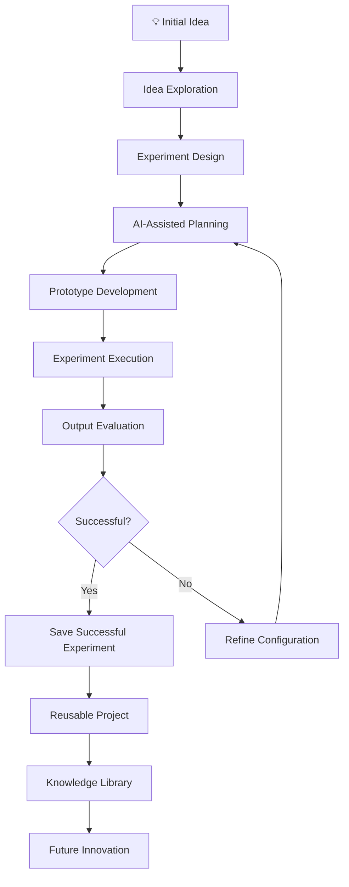

The architecture emphasizes iterative improvement rather than one-time AI generation.

A successful experiment should be reproducible, documented, evaluated, and available for future use.

## 1.4 Design Principles

**Modularity**

The platform should allow independent development of AI providers, experimentation tools, workflows, storage services, and user interface components.

**Extensibility**

New model providers, experiment categories, plugins, and processing capabilities should be added without rewriting the entire application.

**Reproducibility**

Experiments should retain their input parameters, prompt versions, model configurations, timestamps, and output references.

**Observability**

Users and developers should be able to understand what occurred during an experiment and identify unsuccessful execution stages.

**Human Control**

AI-generated outputs should remain reviewable and editable. AI suggestions should not automatically become approved project decisions.

**Responsible AI**

The platform should support privacy controls, transparent AI-generated content labeling, data minimization, and appropriate human review.

---

# 2. VISION, MISSION & PRODUCT PHILOSOPHY

## 2.1 Vision

Create an accessible innovation environment where curiosity can become structured experimentation.

WooHoo Wonder Labs approaches AI as an enabling technology for exploration, discovery, and creative problem-solving.

The long-term vision is to connect:

- Artificial intelligence.
- Creative technologies.
- Scientific exploration.
- Educational experimentation.
- Computational intelligence.
- Software prototyping.
- Knowledge management.
- Intelligent automation.

## 2.2 Mission

The mission is to reduce the complexity between having an idea and exploring whether that idea can become something useful.

Traditional development environments frequently require users to move between separate tools for research, brainstorming, prototyping, documentation, and testing.

WooHoo Wonder Labs proposes integrating those activities into one cohesive workspace.

## 2.3 Product Philosophy

The platform follows five principles.

### Principle 1: Explore before committing

Users should be able to investigate an idea without committing to an entire development project.

### Principle 2: Make experimentation repeatable

Experimental configurations should be preserved and versioned.

### Principle 3: Support different forms of intelligence

The architecture should accommodate language models, vision systems, embeddings, traditional algorithms, and deterministic processing.

### Principle 4: Preserve the human creative process

The system should expand creative possibilities rather than eliminate human direction.

### Principle 5: Turn outputs into reusable knowledge

Successful discoveries should become searchable and reusable resources.

## 2.4 User Personas

| Persona | Primary Needs | Platform Value |
|---|---|---|
| Independent developer | Rapid prototyping | AI-assisted development |
| Creative professional | Explore concepts | Multimodal creative workflows |
| Researcher | Organize experiments | Reproducibility and evaluation |
| Educator | Demonstrations and learning | Structured experimentation |
| Product designer | Validate ideas | Prototype exploration |
| Innovation team | Organize collaboration | Shared knowledge and workflows |

## 2.5 Product Experience

The intended user journey:


This lifecycle should be reflected throughout the product's navigation, interface, data model, and backend services.

---

# 3. PLATFORM ARCHITECTURE

## 3.1 Architecture Overview

WooHoo Wonder Labs is designed around a modular, service-oriented architecture.

The architecture separates the presentation layer from application logic, AI execution, persistence, and external integrations.

This separation provides a foundation for independent scaling and easier maintenance.

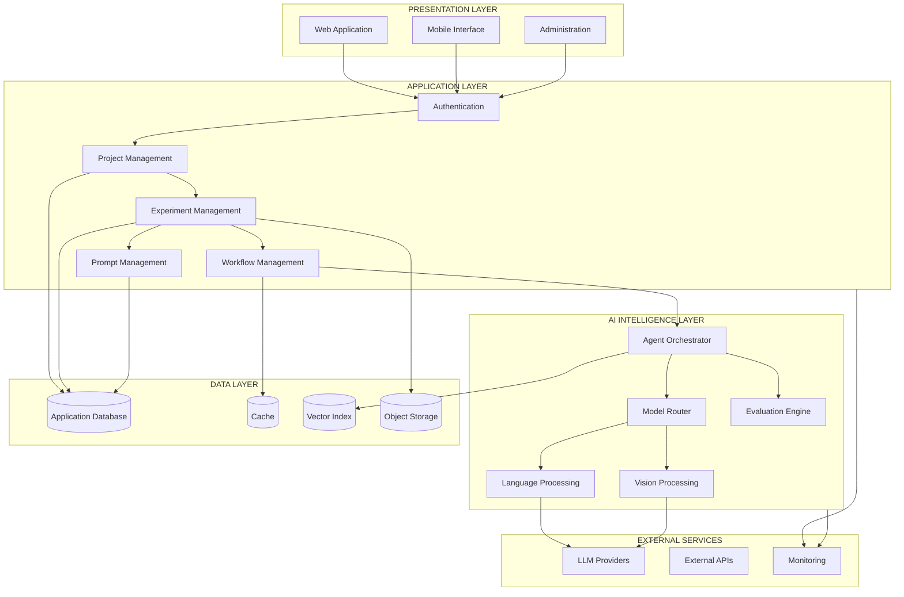

## 3.2 Architectural Layers

### Presentation Layer

Responsible for all user-facing interactions.

Responsibilities:

- Authentication screens.
- Dashboard navigation.
- Experiment configuration.
- Prompt editing.
- Project management.
- Result visualization.
- Workflow monitoring.
- Experiment history.

### Application Layer

Contains business logic and application-specific operations.

Responsibilities:

- Project creation.
- Experiment lifecycle management.
- Workspace permissions.
- Configuration validation.
- Prompt versioning.
- Workflow execution requests.
- Artifact management.

### Intelligence Layer

Responsible for AI-related execution.

Responsibilities:

- Model selection.
- Provider integration.
- Prompt construction.
- Agent execution.
- Multimodal processing.
- Result validation.
- Evaluation.

### Data Layer

Provides durable persistence and retrieval.

Responsibilities:

- User accounts.
- Workspace metadata.
- Project records.
- Experiment history.
- AI execution records.
- Uploaded assets.
- Search indexes.
- Evaluation results.

## 3.3 Separation of Concerns

The platform should avoid embedding AI provider logic directly into frontend components.

Instead, the frontend should communicate with application services, which delegate execution to the intelligence layer.

This ensures that switching between AI providers does not require changing the user interface.

## 3.4 Suggested Repository Organization

The following is a proposed logical organization. Adapt it to the actual repository.

```text
woohoo-wonder-labs/
│
├── README.md
├── LICENSE
├── CONTRIBUTING.md
├── SECURITY.md
├── CHANGELOG.md
│
├── apps/
│   ├── web/
│   │   ├── components/
│   │   ├── pages/
│   │   ├── features/
│   │   ├── hooks/
│   │   ├── services/
│   │   └── styles/
│   │
│   └── mobile/
│
├── services/
│   ├── api/
│   ├── ai-engine/
│   ├── orchestration/
│   ├── experiment-engine/
│   ├── evaluation/
│   └── asset-processing/
│
├── packages/
│   ├── shared-types/
│   ├── validation/
│   ├── prompt-library/
│   ├── ai-adapters/
│   └── utilities/
│
├── infrastructure/
│   ├── docker/
│   ├── deployment/
│   ├── monitoring/
│   └── database/
│
├── docs/
│   ├── architecture/
│   ├── api/
│   ├── security/
│   └── product/
│
├── scripts/
│
└── tests/
    ├── unit/
    ├── integration/
    ├── e2e/
    ├── performance/
    └── evaluation/
```

---

# 4. AI INTELLIGENCE INFRASTRUCTURE

## 4.1 Overview

The AI Intelligence Layer provides a centralized interface for interacting with different AI capabilities.

Rather than binding the application to one provider, the platform should use a provider-independent abstraction.

This architecture allows models to be changed, evaluated, or supplemented without restructuring the application.

## 4.2 AI Capability Categories

| Category | Function |
|---|---|
| Language Models | Reasoning and text generation |
| Embedding Models | Semantic representations |
| Vision Models | Image understanding |
| Speech Models | Audio transcription and processing |
| Generative Models | Creative content generation |
| Classification Models | Categorization |
| Predictive Models | Forecasting and estimation |
| Deterministic Algorithms | Reproducible computation |

## 4.3 Model Router

The model router determines which provider and capability should handle a request.

Inputs include:

- Requested capability.
- Selected provider.
- Model configuration.
- Context length.
- Latency requirements.
- Cost constraints.
- Data handling requirements.
- Model availability.

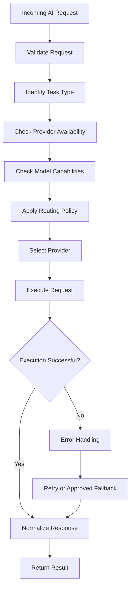

## 4.4 Provider Adapter Pattern

Each external model provider should implement a shared interface.

Example TypeScript contract:

```typescript
export interface AIMessage {
  role: "system" | "user" | "assistant";
  content: string;
}

export interface AIRequest {
  messages: AIMessage[];
  model?: string;
  temperature?: number;
  maxTokens?: number;
  metadata?: Record<string, unknown>;
}

export interface AIResponse {
  content: string;
  model: string;
  provider: string;
  usage?: {
    inputTokens?: number;
    outputTokens?: number;
  };
  finishReason?: string;
}

export interface AIProvider {
  readonly name: string;

  generate(
    request: AIRequest
  ): Promise<AIResponse>;

  validateConfiguration(): Promise<boolean>;

  getCapabilities(): Promise<string[]>;
}
```

Individual provider implementations can then be isolated.

```typescript
class ProviderRegistry {
  private providers = new Map<string, AIProvider>();

  register(provider: AIProvider): void {
    if (this.providers.has(provider.name)) {
      throw new Error(
        `Provider already registered: ${provider.name}`
      );
    }

    this.providers.set(provider.name, provider);
  }

  get(name: string): AIProvider {
    const provider = this.providers.get(name);

    if (!provider) {
      throw new Error(
        `Unknown AI provider: ${name}`
      );
    }

    return provider;
  }

  list(): string[] {
    return [...this.providers.keys()];
  }
}
```

## 4.5 Model Selection Policies

The platform can support several policies.

**Capability-first routing:** Choose a model capable of processing the requested input.

**Quality-first routing:** Prefer models with stronger evaluation results for the relevant task.

**Latency-aware routing:** Prefer providers meeting defined response-time requirements.

**Cost-aware routing:** Prefer providers operating within a configured budget.

**Privacy-aware routing:** Restrict sensitive data to approved processing environments.

These policies should be configurable and transparent.

## 4.6 Resilient Execution

AI requests should support:

- Request timeouts.
- Exponential backoff.
- Provider-specific retry policies.
- Request cancellation.
- Idempotency keys.
- Usage accounting.
- Structured error responses.
- Circuit breakers.
- Fallback models where authorized.

A fallback should never silently change a privacy or data residency requirement.

---

# 5. MULTI-AGENT ORCHESTRATION

## 5.1 Agent Architecture

WooHoo Wonder Labs can use specialized agents to divide complex experimentation tasks into smaller, more manageable operations.

An agent should have a defined responsibility, bounded context, permitted tools, input schema, output schema, and execution policy.

## 5.2 Proposed Agent Roles

| Agent | Responsibility |
|---|---|
| Research Agent | Organize background information |
| Ideation Agent | Generate alternative concepts |
| Planning Agent | Produce experiment plans |
| Technical Agent | Analyze implementation requirements |
| Creative Agent | Explore creative directions |
| Validation Agent | Check outputs against requirements |
| Evaluation Agent | Compare experimental results |
| Documentation Agent | Generate structured documentation |
| Coordinator Agent | Delegate tasks and consolidate outputs |

These are proposed functional roles, not assertions about currently deployed agents.

## 5.3 Agent Collaboration Architecture

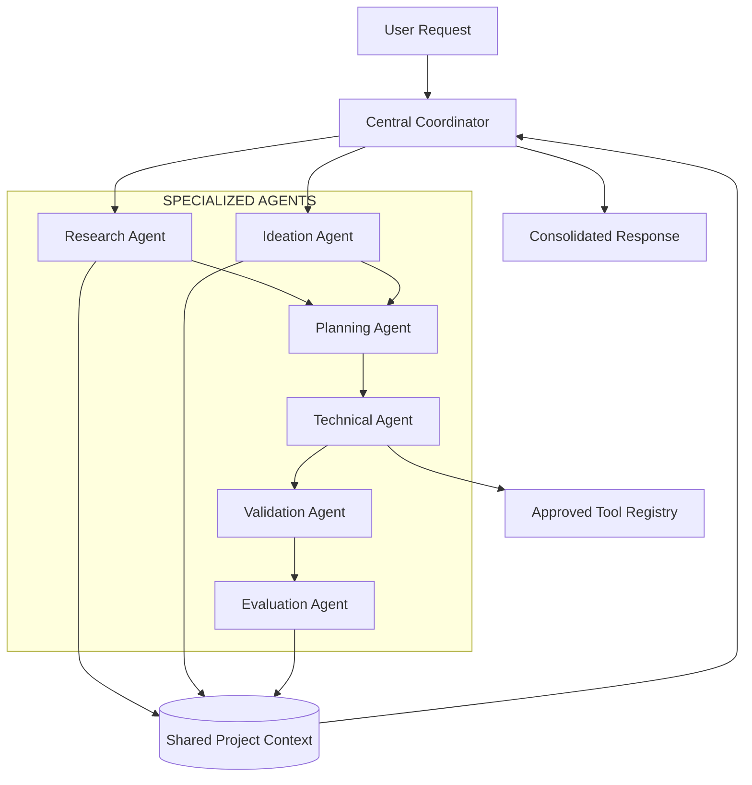

## 5.4 Agent Execution Lifecycle

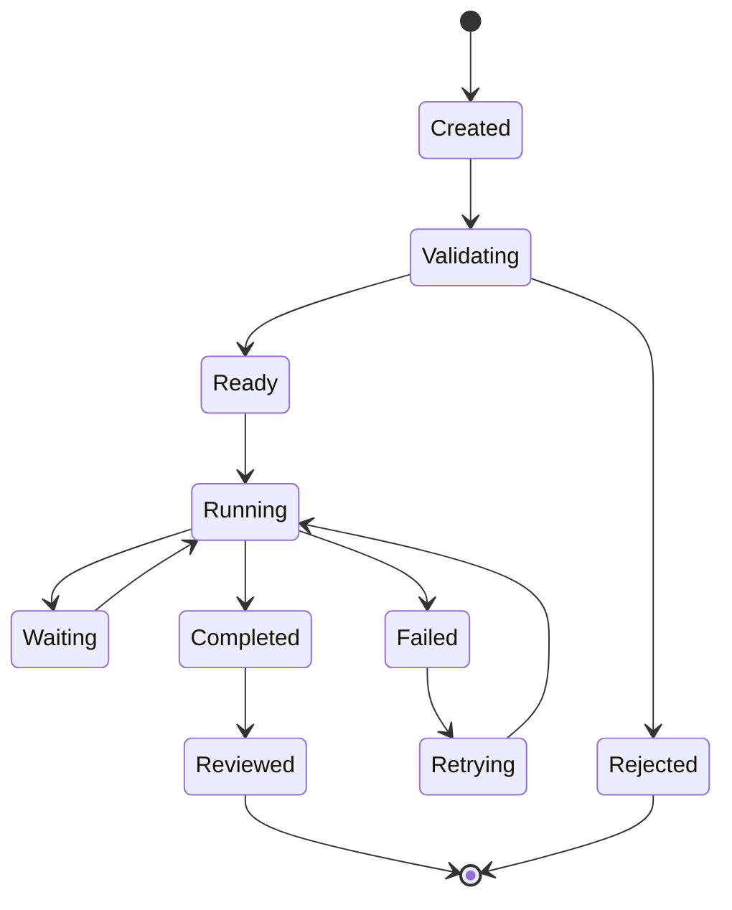

## 5.5 Agent Configuration

Example configuration:

```typescript
export interface AgentConfig {
  id: string;
  name: string;
  description: string;
  role: string;

  capabilities: string[];

  systemPrompt: string;

  allowedTools: string[];

  maxSteps: number;

  timeoutMs: number;

  requiresHumanApproval: boolean;
}
```

The `requiresHumanApproval` setting provides a mechanism for requiring explicit review before actions with meaningful external effects.

## 5.6 Delegation and Task Management

Complex requests should be decomposed into independent tasks.

Each task should have:

- Unique identifier.
- Parent execution identifier.
- Assigned agent.
- Task description.
- Input context.
- Expected output.
- Execution status.
- Start timestamp.
- Completion timestamp.
- Error information.

The coordinator should retain ownership of the overall objective and decide how to combine outputs.

## 5.7 Agent Communication

An event-based architecture can coordinate agent activities.

Example event:

```typescript
interface AgentTaskEvent {
  eventId: string;
  executionId: string;
  taskId: string;
  agentId: string;

  type:
    | "task.created"
    | "task.started"
    | "task.completed"
    | "task.failed";

  timestamp: string;

  payload: Record<string, unknown>;
}
```

Events should be validated before entering the execution pipeline.

## 5.8 Preventing Uncontrolled Agent Execution

Agent orchestration must have bounded execution.

Recommended controls:

- Maximum task count.
- Maximum agent iterations.
- Maximum execution duration.
- Maximum model usage.
- Tool allowlists.
- Per-project resource limits.
- Cancellation support.
- Human approval gates.
- Structured output validation.

The platform should avoid uncontrolled recursive delegation or unlimited agent-to-agent conversations.

---

# 6. CREATIVE EXPERIMENTATION ENGINE

## 6.1 Purpose

The Experimentation Engine is the central mechanism for converting an idea into an organized, executable experiment.

Each experiment should be treated as a structured object with an identifiable objective, configuration, inputs, outputs, and evaluation criteria.

## 6.2 Experiment Components

```typescript
export interface Experiment {
  id: string;

  projectId: string;

  name: string;

  description: string;

  category: string;

  status:
    | "draft"
    | "configured"
    | "queued"
    | "running"
    | "completed"
    | "failed"
    | "cancelled";

  configuration: Record<string, unknown>;

  inputReferences: string[];

  outputReferences: string[];

  evaluationId?: string;

  createdAt: string;

  updatedAt: string;
}
```

## 6.3 Experiment Pipeline

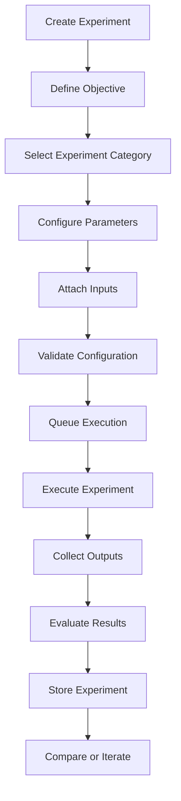

## 6.4 Experiment Categories

The platform should support extensible categories such as:

**Creative exploration**

Investigating variations of ideas, narratives, concepts, and design directions.

**AI experimentation**

Comparing AI model configurations, prompts, and outputs.

**Technical prototyping**

Exploring software architectures, API interactions, and implementation strategies.

**Scientific exploration**

Organizing computational experiments and recording research parameters.

**Educational experimentation**

Creating guided explorations and structured learning activities.

**Automation experiments**

Evaluating workflow behavior and different automation configurations.

## 6.5 Experiment Versioning

A change in an experiment's parameters should produce a new configuration version.

Example:

```typescript
interface ExperimentVersion {
  id: string;
  experimentId: string;
  versionNumber: number;

  configuration: Record<string, unknown>;

  promptVersion?: string;

  modelConfiguration?: {
    provider: string;
    model: string;
    parameters: Record<string, unknown>;
  };

  createdAt: string;
  createdBy: string;
}
```

The system should not overwrite historical configurations.

## 6.6 Experiment Comparison

Users should be able to compare two or more executions.

Comparison dimensions include:

- Input parameters.
- Prompt configuration.
- Model selection.
- Output quality.
- Execution duration.
- Resource consumption.
- Evaluation scores.
- Error frequency.

A comparison should clearly distinguish measured values from subjective assessments.

## 6.7 Reproducibility

Every experiment execution should preserve sufficient metadata to support reconstruction.

Recommended metadata:

```json
{
  "executionId": "execution-example-001",
  "experimentId": "experiment-example-001",
  "version": 3,
  "createdAt": "2026-10-31T12:00:00Z",
  "configurationHash": "sha256-example",
  "provider": "configured-provider",
  "model": "configured-model",
  "seed": null,
  "status": "completed"
}
```

A reproducibility record must also capture external dependencies that may change, such as provider model versions.

---

# 7. PROJECT AND WORKSPACE MANAGEMENT

## 7.1 Workspace Architecture

A workspace represents a logical environment in which projects, experiments, assets, and collaborators are organized.

A project belongs to a workspace.

A workspace may contain multiple projects.

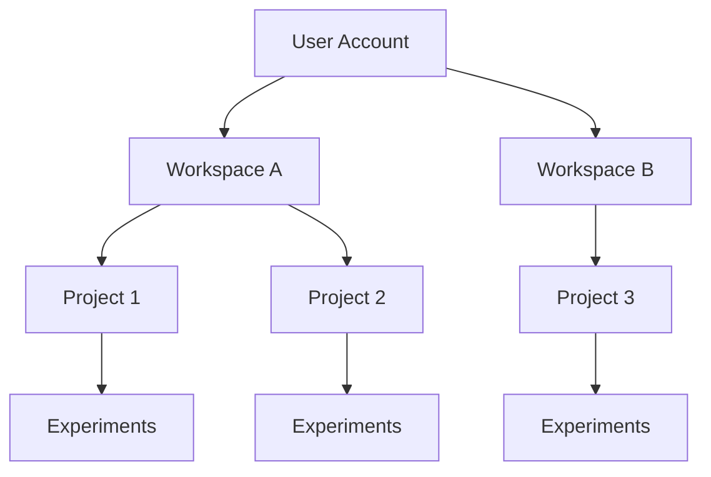

## 7.2 Project Metadata

A project should contain:

| Field | Description |
|---|---|
| Project ID | Unique identifier |
| Workspace ID | Parent workspace |
| Name | Project title |
| Description | Project objective |
| Category | Project classification |
| Status | Current lifecycle status |
| Owner | Project creator |
| Tags | Searchable labels |
| Created At | Creation timestamp |
| Updated At | Last modification |

## 7.3 Workspace Roles

A role-based access model can support:

- Owner.
- Administrator.
- Editor.
- Contributor.
- Viewer.

Permissions should be verified on the backend for each protected resource.

Hiding an interface button is not an authorization mechanism.

## 7.4 Project Activity History

The activity system should capture significant events.

Examples:

- Project created.
- Experiment launched.
- Prompt updated.
- Asset uploaded.
- Experiment completed.
- Evaluation recorded.
- Project archived.
- Member invited.

Activity records should include actor, event type, timestamp, and relevant resource references.

## 7.5 Search and Discovery

Project search should eventually support:

- Project title search.
- Description search.
- Tag filtering.
- Experiment search.
- Asset metadata search.
- Semantic search when configured.

Search results must respect workspace access permissions.

---

# 8. PROMPT ENGINEERING & INTELLIGENCE MANAGEMENT

## 8.1 Prompt Management

Prompts are part of the application's core intellectual infrastructure.

Rather than storing prompts as unstructured strings throughout the codebase, the platform should use a managed prompt registry.

## 8.2 Prompt Lifecycle

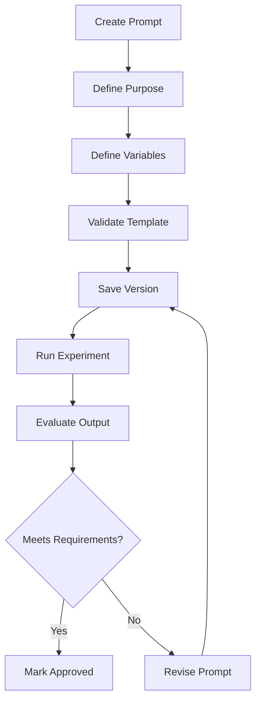

## 8.3 Prompt Structure

Example:

```typescript
interface PromptTemplate {
  id: string;

  name: string;

  description: string;

  version: number;

  systemInstruction: string;

  userTemplate: string;

  variables: PromptVariable[];

  category: string;

  createdAt: string;
}

interface PromptVariable {
  name: string;

  type:
    | "string"
    | "number"
    | "boolean"
    | "json";

  required: boolean;

  description: string;

  defaultValue?: unknown;
}
```

## 8.4 Prompt Example

```text
SYSTEM:
You are an experimental ideation assistant.

Your role is to help explore a concept through
structured reasoning and alternative approaches.

USER:
Project: {{project_name}}

Objective:
{{objective}}

Constraints:
{{constraints}}

Deliverables:
{{deliverables}}

Return:
1. Summary
2. Key assumptions
3. Alternative approaches
4. Potential limitations
5. Suggested next experiment
```

## 8.5 Prompt Version Control

Each revision should preserve:

- Prompt identifier.
- Version number.
- Template content.
- Change description.
- Creator.
- Timestamp.
- Associated experiments.

This enables comparisons between prompt revisions.

## 8.6 Prompt Evaluation

Prompt evaluation can include:

| Metric | Description |
|---|---|
| Relevance | Alignment with the intended objective |
| Completeness | Coverage of requested elements |
| Consistency | Stability across repeated trials |
| Format Compliance | Conformance with output schemas |
| Accuracy | Agreement with verifiable references |
| Latency | Response duration |
| Token Usage | Input and output consumption |

An automated evaluator should not be treated as definitive proof of factual correctness.

---

# 9. DATA ARCHITECTURE & KNOWLEDGE MANAGEMENT

## 9.1 Data Architecture

A logical data architecture separates structured records from files and semantic indexes.

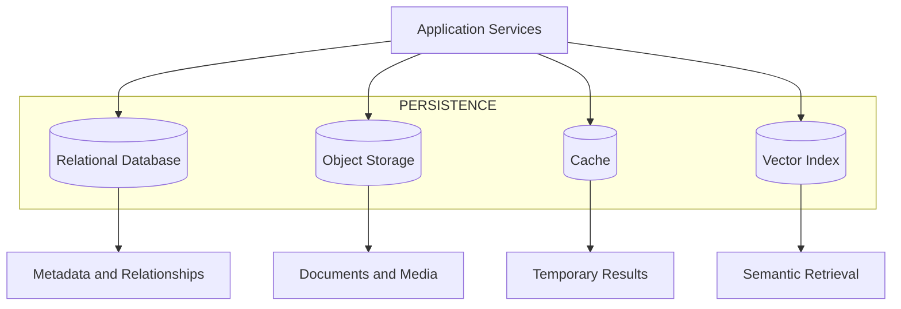

The actual infrastructure should be selected according to repository requirements.

## 9.2 Conceptual Database Schema

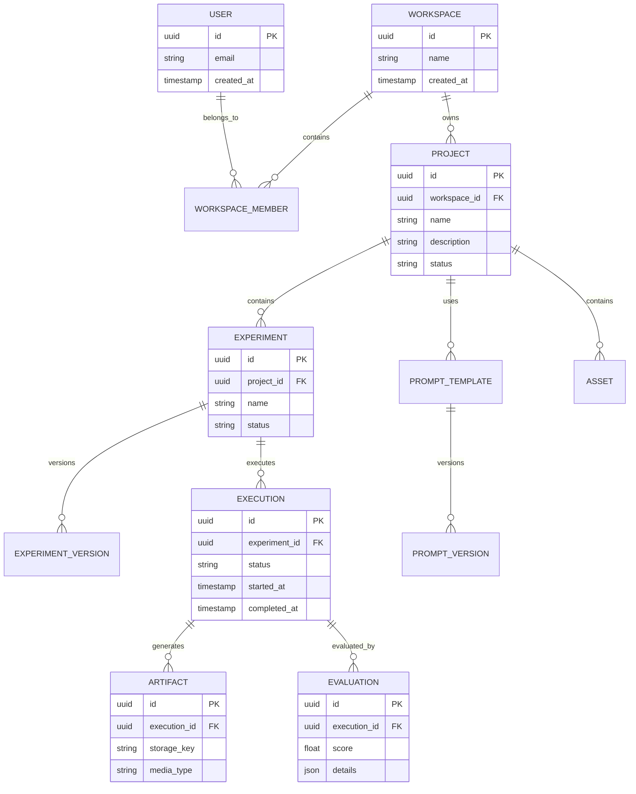

This diagram describes the intended relationship model, not an inspected production database.

## 9.3 Knowledge Management

A project knowledge layer can preserve information across experiments.

Potential data sources:

- Project descriptions.
- Uploaded documents.
- Experiment configurations.
- Historical outputs.
- Technical notes.
- Prompt templates.
- Evaluation results.
- Reference materials.

## 9.4 Semantic Retrieval

Where a vector database or embedding service is available, semantic retrieval can improve contextual discovery.

Conceptual pipeline:

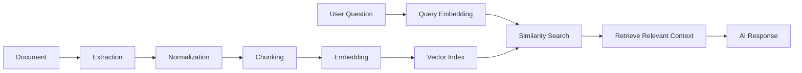

## 9.5 Document Chunking

A document-processing component should:

1. Validate the incoming file.
2. Identify the document type.
3. Extract supported content.
4. Normalize text.
5. Divide content into meaningful sections.
6. Preserve page and section metadata.
7. Create embeddings when enabled.
8. Store source references.
9. Make the indexed content searchable.

Chunk boundaries should avoid unnecessary fragmentation of meaningful passages.

## 9.6 Data Provenance

Every generated output should retain information about its sources.

An artifact may reference:

- Original uploaded files.
- Prompt versions.
- Model configuration.
- Experiment identifiers.
- Execution identifiers.
- Human modifications.

This creates a traceable relationship between an idea and the final output.

---

# 10. MULTIMODAL AI PROCESSING

## 10.1 Overview

WooHoo Wonder Labs is designed to accommodate different forms of input and output.

Multimodal capability should be implemented through a dedicated processing layer rather than assuming every model can process every media format.

## 10.2 Supported Media Categories

| Modality | Potential Processing |
|---|---|
| Text | Classification and generation |
| Images | Visual description and analysis |
| Audio | Transcription and sound processing |
| Video | Frame extraction and summarization |
| Documents | Text and structured data extraction |
| Structured Data | Statistical and computational processing |

The actual supported formats depend on the configured providers and application implementation.

## 10.3 Multimodal Architecture

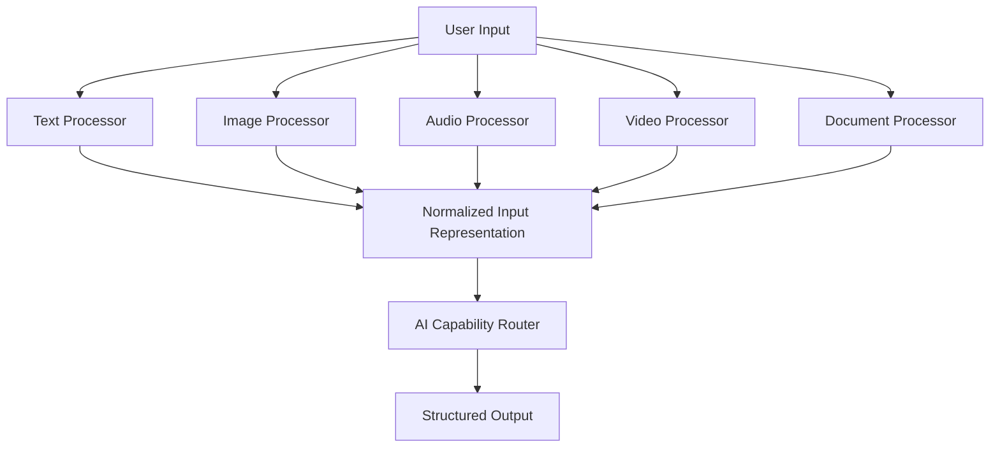

## 10.4 Image Processing Pipeline

A proposed image-processing service:

```typescript
interface ImageProcessingRequest {
  assetId: string;

  operation:
    | "describe"
    | "classify"
    | "compare"
    | "extract";

  instructions?: string;

  metadata?: Record<string, unknown>;
}

interface ImageProcessingResult {
  assetId: string;

  description?: string;

  labels?: string[];

  extractedData?: Record<string, unknown>;

  provider?: string;

  model?: string;
}
```

Processing should include file validation, image metadata extraction, appropriate resizing, and privacy controls.

## 10.5 Audio Processing Pipeline

Possible audio functionality:

- Speech transcription.
- Speaker-independent content organization.
- Audio summarization.
- Speech-to-text conversion.
- Structured transcript export.

The application must make clear when audio is transmitted to an external provider.

## 10.6 Video Processing Pipeline

Video processing may use:

1. Video metadata extraction.
2. Frame selection.
3. Frame preprocessing.
4. Scene organization.
5. Supported visual analysis.
6. Timestamp preservation.
7. Output summarization.

Video processing must enforce duration, size, and resource limits.

## 10.7 Multimodal Result Normalization

Regardless of input type, the application should return a consistent result structure.

```typescript
interface ProcessingResult {
  id: string;

  sourceAssetId: string;

  modality: string;

  status: "completed" | "failed";

  content: unknown;

  metadata: {
    provider?: string;
    model?: string;
    durationMs?: number;
  };

  createdAt: string;
}
```

This standardization makes it easier for other services to consume processing outputs.

---

# 11. WORKFLOW AUTOMATION ENGINE

## 11.1 Workflow Architecture

The workflow engine connects individual operations into repeatable processes.

An experiment may consist of several independent or sequential tasks.

A workflow should have explicit inputs, outputs, dependencies, and failure behavior.

## 11.2 Workflow Components

- Trigger.
- Input validation.
- Task execution.
- Conditional branching.
- Data transformation.
- AI operation.
- Human review.
- Output storage.
- Completion event.

## 11.3 Workflow Diagram

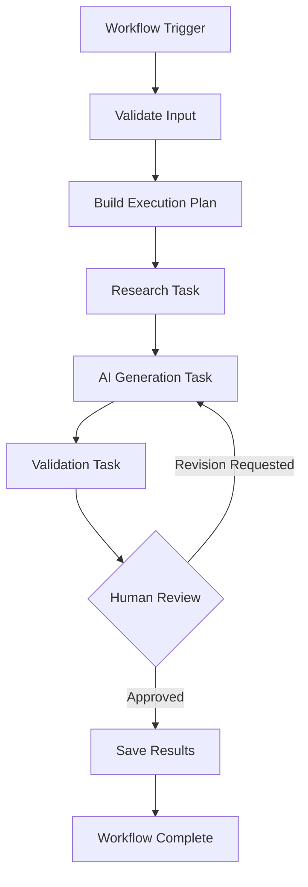

## 11.4 Workflow Definition

Example YAML:

```yaml
workflow:
  id: idea-exploration
  name: Idea Exploration

  version: 1

  inputs:
    - name: concept
      type: string
      required: true

    - name: objective
      type: string
      required: true

  steps:

    - id: analyze
      type: ai
      task: analyze-concept

    - id: explore
      type: ai
      task: generate-alternatives
      depends_on:
        - analyze

    - id: validate
      type: validation
      depends_on:
        - explore

    - id: save
      type: artifact
      depends_on:
        - validate

  execution:
    max_duration_seconds: 300
    allow_cancellation: true
```

This is an illustrative workflow configuration.

## 11.5 Workflow State Management

Each execution should have a durable state.

Suggested states:

- Created.
- Validating.
- Queued.
- Running.
- Waiting for review.
- Completed.
- Failed.
- Cancelled.

Workflow state changes should be validated by the backend.

## 11.6 Retry Strategy

A retry should distinguish between temporary failures and permanent errors.

Potential retryable conditions include:

- Temporary network failures.
- Provider rate limits.
- Temporary service unavailability.

Permanent errors may include:

- Invalid input.
- Unsupported file format.
- Invalid authentication.
- Schema validation failure.

The retry mechanism should use bounded exponential backoff and preserve execution identifiers.

---

# 12. BACKEND ARCHITECTURE & APIs

## 12.1 API Design

The API should provide a consistent interface between the frontend, application services, and AI execution infrastructure.

Recommended design characteristics:

- Resource-oriented endpoints.
- Versioned API paths.
- Consistent JSON responses.
- Schema validation.
- Authentication.
- Authorization.
- Pagination.
- Request correlation IDs.
- Structured error handling.

## 12.2 Example API Structure

The following endpoints define a proposed API contract.

| Method | Endpoint | Purpose |
|---|---|---|
| GET | `/api/v1/health` | Service health |
| GET | `/api/v1/projects` | List projects |
| POST | `/api/v1/projects` | Create project |
| GET | `/api/v1/projects/:id` | Retrieve project |
| PATCH | `/api/v1/projects/:id` | Update project |
| DELETE | `/api/v1/projects/:id` | Delete project |
| GET | `/api/v1/experiments` | List experiments |
| POST | `/api/v1/experiments` | Create experiment |
| POST | `/api/v1/experiments/:id/run` | Execute experiment |
| GET | `/api/v1/executions/:id` | Inspect execution |
| POST | `/api/v1/ai/generate` | Request AI output |
| GET | `/api/v1/prompts` | List prompt templates |
| POST | `/api/v1/prompts` | Create prompt template |
| POST | `/api/v1/assets` | Upload asset |
| GET | `/api/v1/evaluations/:id` | Retrieve evaluation |

These routes should be reconciled with the real backend before being advertised as implemented.

## 12.3 API Request Example

```http
POST /api/v1/experiments
Content-Type: application/json
Authorization: Bearer <ACCESS_TOKEN>
```

Request:

```json
{
  "projectId": "project-example",
  "name": "Creative Exploration",
  "description": "Explore alternative product concepts.",
  "category": "ideation",
  "configuration": {
    "outputCount": 5,
    "format": "structured"
  }
}
```

Illustrative response:

```json
{
  "success": true,
  "data": {
    "id": "experiment-example",
    "status": "draft",
    "name": "Creative Exploration"
  }
}
```

## 12.4 Execution API

An execution request should return a durable execution identifier.

```http
POST /api/v1/experiments/experiment-example/run
```

Illustrative response:

```json
{
  "success": true,
  "data": {
    "executionId": "execution-example",
    "status": "queued"
  }
}
```

The client can subsequently retrieve execution status.

```http
GET /api/v1/executions/execution-example
```

## 12.5 Standard Error Format

```json
{
  "success": false,
  "error": {
    "code": "VALIDATION_ERROR",
    "message": "The supplied experiment configuration is invalid.",
    "requestId": "request-example",
    "details": []
  }
}
```

Do not expose credentials, internal stack traces, or sensitive provider responses in client-facing error messages.

## 12.6 API Sequence Diagram

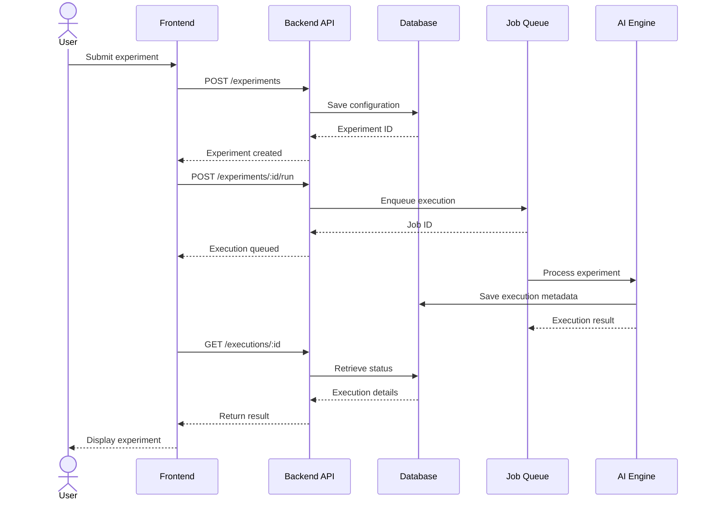

---

# 13. FRONTEND ARCHITECTURE & EXPERIENCE

## 13.1 Interface Philosophy

The frontend should make advanced experimentation understandable without exposing unnecessary implementation complexity.

The interface should prioritize:

- Clear navigation.
- Responsive layouts.
- Accessible interactions.
- Visual hierarchy.
- Understandable execution states.
- Useful empty states.
- Immediate feedback.
- Consistent design components.

## 13.2 Suggested Navigation

```text
WooHoo Wonder Labs
│
├── Dashboard
│
├── Wonder Studio
│   ├── New Experiment
│   ├── Explore Ideas
│   ├── AI Workspace
│   └── Recent Experiments
│
├── Projects
│   ├── All Projects
│   ├── Active Projects
│   └── Archived Projects
│
├── AI Intelligence
│   ├── Model Configuration
│   ├── Prompt Library
│   ├── Agent Workspace
│   └── AI History
│
├── Knowledge Library
│   ├── Documents
│   ├── Assets
│   └── Saved Results
│
├── Workflows
│
├── Analytics
│
└── Settings
    ├── Profile
    ├── Workspace
    ├── Security
    └── Integrations
```

## 13.3 Dashboard Architecture

The dashboard should provide a high-level overview of current activity.

Recommended components:

**Welcome Panel**

A contextual starting point for new experiments.

**Project Overview**

Active and recently modified projects.

**Recent Experiments**

The latest experiment runs and their statuses.

**AI Activity**

A summary of recent AI executions and usage.

**Workflow Activity**

Running, completed, and failed workflows.

**Knowledge Library**

Quick access to saved research and artifacts.

## 13.4 Wonder Studio

The central experimentation interface should support:

- Experiment title.
- Objective.
- Category.
- Input editor.
- Configuration panel.
- AI provider selection.
- Prompt selection.
- Execution controls.
- Output viewer.
- Comparison mode.
- Save and version controls.

## 13.5 UI State Management

Frontend state should distinguish between:

**Local interface state**

Open panels, active tabs, dialog visibility, and editor state.

**Server state**

Projects, experiment records, execution statuses, and stored assets.

**Persistent configuration state**

User settings, saved preferences, and workspace configuration.

Avoid treating transient component state as durable application data.

## 13.6 Component Structure

Example:

```text
components/
│
├── layout/
│   ├── AppShell
│   ├── Sidebar
│   ├── Header
│   └── Navigation
│
├── dashboard/
│   ├── WelcomePanel
│   ├── ProjectOverview
│   ├── ActivityFeed
│   └── UsageOverview
│
├── experiments/
│   ├── ExperimentEditor
│   ├── ExperimentConfig
│   ├── ExperimentStatus
│   ├── ExperimentResults
│   └── ExperimentComparison
│
├── ai/
│   ├── ModelSelector
│   ├── PromptEditor
│   ├── AgentPanel
│   └── GenerationResult
│
└── shared/
    ├── Button
    ├── Modal
    ├── Input
    ├── Card
    └── EmptyState
```

## 13.7 Interaction Design

The interface should provide feedback for every meaningful operation.

Examples:

- Saving a project.
- Starting an experiment.
- Uploading an asset.
- Switching models.
- Editing a prompt.
- Cancelling execution.
- Viewing an evaluation.
- Retrying a failed operation.

Long-running AI operations should display their status without requiring the user to keep the screen active.

---

# 14. EXPERIMENT EVALUATION & BENCHMARKING

## 14.1 Evaluation Philosophy

An experimentation platform should distinguish between producing an output and establishing whether that output is useful.

The Evaluation Engine provides mechanisms for examining the quality and performance of experimental outputs.

## 14.2 Evaluation Dimensions

| Dimension | Purpose |
|---|---|
| Relevance | Does the output address the objective? |
| Accuracy | Is the output factually supported? |
| Completeness | Are requested elements present? |
| Consistency | Are results sufficiently stable? |
| Format | Does the output follow the required schema? |
| Performance | How long did execution take? |
| Cost | What resources were consumed? |
| Reproducibility | Can the execution be reconstructed? |

## 14.3 Evaluation Pipeline

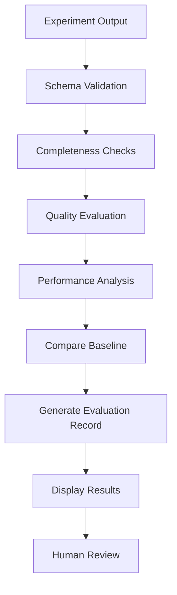

## 14.4 Evaluation Record

```typescript
interface EvaluationRecord {
  id: string;

  executionId: string;

  evaluator: string;

  metrics: {
    relevance?: number;
    completeness?: number;
    formatCompliance?: number;
    consistency?: number;
  };

  warnings: string[];

  findings: string[];

  humanReviewed: boolean;

  createdAt: string;
}
```

Scoring scales should be explicitly documented.

For example, if normalized to zero through one, a score of `0.85` means 85% of the defined scoring scale, not necessarily 85% factual accuracy.

## 14.5 Model Benchmarking

The platform may support controlled comparisons between model configurations.

A benchmark should preserve:

- Dataset or test case version.
- Prompt version.
- Model identifier.
- Provider.
- Model parameters.
- Evaluation method.
- Execution time.
- Token usage.
- Output references.

## 14.6 A/B Experimentation

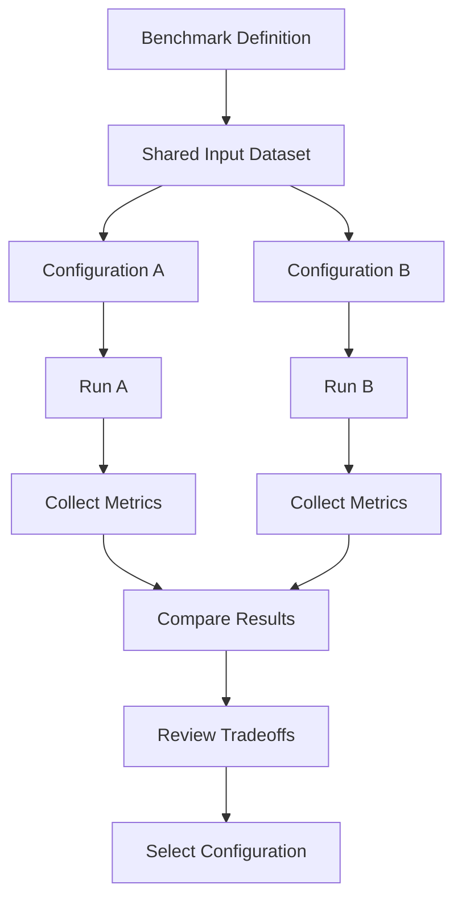

Comparisons should use equivalent input conditions whenever possible.

## 14.7 Evaluation Limitations

Automated evaluations can be affected by evaluator bias, model changes, inconsistent data, and ambiguous scoring criteria.

Evaluation results should therefore include their methodology and limitations.

Human review remains important for consequential or subjective outputs.

---

# 15. SECURITY, PRIVACY & GOVERNANCE

## 15.1 Security Architecture

Security should be incorporated throughout the application rather than implemented as a separate feature.

Primary protection areas:

- Authentication.
- Authorization.
- Data isolation.
- Secrets management.
- Input validation.
- File processing.
- API protection.
- Logging.
- AI provider security.
- Auditability.

## 15.2 Authentication

The authentication system should support secure user sessions and account recovery.

Recommended controls include:

- Secure password handling where passwords are supported.
- Session expiration.
- Secure cookies where applicable.
- Account verification.
- Rate limiting.
- Multi-factor authentication where appropriate.
- Session revocation.

## 15.3 Authorization

Every protected request should verify:

1. The user is authenticated.
2. The requested resource exists.
3. The resource belongs to an accessible workspace.
4. The user has the necessary permission.
5. The requested action is allowed.

## 15.4 API Key Management

External AI credentials must never be embedded in client-side application code.

Recommended design:

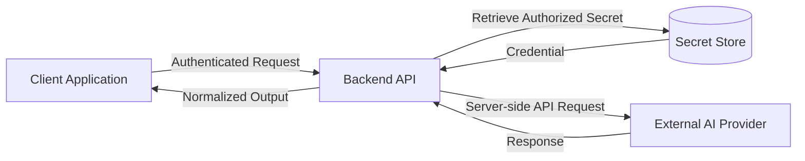

Secrets should be:

- Stored outside source control.
- Encrypted at rest.
- Restricted by access policy.
- Rotated as necessary.
- Removed when no longer needed.
- Excluded from logs.

## 15.5 Data Privacy

The platform should provide clear information about:

- What information is collected.
- Why information is collected.
- Where files are stored.
- Which third parties process requests.
- How long information is retained.
- How information can be deleted.
- Whether data may be used for model improvement.

## 15.6 File Upload Security

File processing should include:

- File size restrictions.
- Content-type validation.
- File signature verification.
- Safe object storage.
- Malware scanning where supported.
- Processing time limits.
- Restricted file parsing.
- Controlled download access.

## 15.7 AI-Specific Security

AI systems introduce additional risks.

The architecture should address:

**Prompt injection**

Treat externally supplied documents and retrieved passages as untrusted data.

**Unauthorized tool execution**

Restrict available tools through explicit permission policies.

**Sensitive data disclosure**

Avoid sending unnecessary personal or confidential information to external providers.

**Unsafe output handling**

Validate generated structured content before processing or displaying it.

**Unbounded resource consumption**

Enforce token, request, and execution budgets.

**Model hallucinations**

Clearly communicate uncertainty and distinguish generated suggestions from verified facts.

## 15.8 Audit Logging

Significant operations should produce audit events.

Example:

```typescript
interface AuditEvent {
  id: string;

  actorId: string;

  workspaceId: string;

  action: string;

  resourceType: string;

  resourceId: string;

  timestamp: string;

  requestId?: string;

  metadata?: Record<string, unknown>;
}
```

Sensitive values, secrets, and unnecessary personal information must not be written to audit logs.

---

# 16. PERFORMANCE, SCALABILITY & RELIABILITY

## 16.1 Scalability Principles

The platform should separate interactive requests from long-running AI execution.

This allows ordinary application requests to remain responsive while computational workloads execute through background workers.

## 16.2 Execution Queue

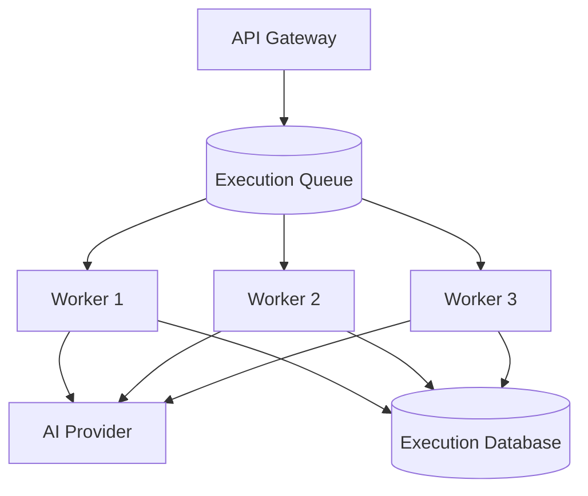

Worker concurrency should be configured according to provider limits, system capacity, and resource budgets.

## 16.3 Caching

Potential caching targets:

- Project metadata.
- Model capability metadata.
- Public configuration.
- Prompt templates.
- Repeated deterministic operations.

Personal information and sensitive experiment outputs should not be cached without appropriate isolation and expiration policies.

## 16.4 Database Optimization

Recommended practices:

- Index frequently queried columns.
- Use pagination.
- Avoid unnecessary full-table scans.
- Separate large media from relational records.
- Monitor query duration.
- Use database transactions for related state changes.
- Review query plans.
- Establish retention policies.

## 16.5 Reliability

Important reliability mechanisms:

- Health checks.
- Service readiness checks.
- Request timeouts.
- Bounded retries.
- Circuit breakers.
- Dead-letter handling.
- Execution cancellation.
- Database backups.
- Graceful shutdown.
- Error monitoring.

## 16.6 Observability Architecture

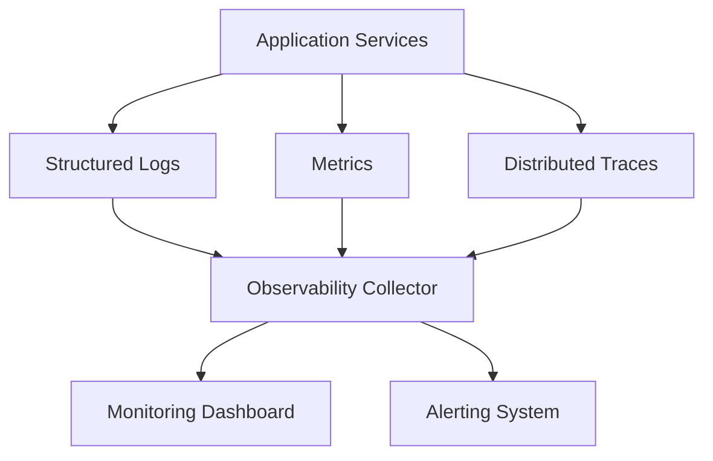

## 16.7 Operational Metrics

Suggested operational measurements:

| Metric | Description |
|---|---|
| API Latency | API request duration |
| Execution Latency | Experiment processing duration |
| Queue Depth | Pending execution count |
| Error Rate | Percentage of failed requests |
| Provider Availability | Availability of configured providers |
| Token Usage | Model consumption |
| Worker Utilization | Worker capacity consumption |
| Database Latency | Query response times |
| Cache Hit Rate | Cache effectiveness |

Targets should be set using actual deployment data rather than invented performance claims.

---

# 17. TESTING & QUALITY ENGINEERING

## 17.1 Testing Philosophy

Testing should verify application behavior across the frontend, backend, AI integrations, and execution pipeline.

The test strategy should distinguish deterministic software tests from probabilistic AI evaluations.

## 17.2 Testing Pyramid

```mermaid
flowchart TB

    E2E["End-to-End Tests"]

    INTEGRATION["Integration Tests"]

    UNIT["Unit Tests"]

    STATIC["Static Analysis and Type Checking"]

    STATIC --> UNIT
    UNIT --> INTEGRATION
    INTEGRATION --> E2E
```

## 17.3 Unit Tests

Test isolated business logic.

Examples:

- Experiment configuration validation.
- Prompt variable substitution.
- Workspace permission evaluation.
- Model routing selection.
- Output schema validation.
- Workflow state transitions.
- Retry policy behavior.

## 17.4 Integration Tests

Test the interaction between:

- API and database.
- API and queue.
- Worker and AI provider adapter.
- Asset service and object storage.
- Evaluation service and execution records.
- Authentication and access control.

External providers should generally be mocked in ordinary automated test suites.

## 17.5 End-to-End Tests

Representative user journeys:

1. Create an account.
2. Create a workspace.
3. Create a project.
4. Start an experiment.
5. Configure an AI request.
6. Execute the experiment.
7. View its output.
8. Evaluate the result.
9. Save the experiment.
10. Retrieve it from experiment history.

## 17.6 AI Evaluation Testing

AI evaluations should use versioned test cases.

Example:

```json
{
  "testCase": "structured-output-001",
  "input": {
    "objective": "Generate five alternative concepts."
  },
  "expected": {
    "minimumItems": 5,
    "requiredFields": [
      "title",
      "description",
      "rationale"
    ]
  }
}
```

Test checks should focus on measurable conditions whenever possible.

## 17.7 Regression Testing

When model configurations, prompts, or processing logic change, previously evaluated test cases should be rerun.

This helps identify unintended performance changes.

## 17.8 Quality Gates

A proposed CI quality gate:

- Code formatting.
- Static analysis.
- Type checking.
- Unit tests.
- Integration tests.
- Dependency vulnerability checks.
- Security checks.
- Build verification.

Deployment should be blocked when mandatory quality gates fail.

---

# 18. DEPLOYMENT & DEVOPS

## 18.1 Deployment Architecture

WooHoo Wonder Labs can be deployed using a modular application infrastructure.

```mermaid
flowchart TB

    USER["Users"]

    CDN["CDN / Edge"]

    FRONT["Frontend Application"]

    GATEWAY["Application API"]

    SERVICES["Backend Services"]

    QUEUE[("Job Queue")]

    WORKERS["Background Workers"]

    DATABASE[("Database")]

    STORAGE[("Object Storage")]

    AI["AI Providers"]

    USER --> CDN
    CDN --> FRONT
    FRONT --> GATEWAY
    GATEWAY --> SERVICES

    SERVICES --> DATABASE
    SERVICES --> STORAGE
    SERVICES --> QUEUE

    QUEUE --> WORKERS
    WORKERS --> AI
    WORKERS --> DATABASE
```

## 18.2 Environment Strategy

Maintain separate environments.

| Environment | Purpose |
|---|---|
| Local | Development |
| Test | Automated testing |
| Staging | Pre-production verification |
| Production | Live application |

Environment credentials should be isolated.

## 18.3 Environment Configuration

The following is an illustrative configuration template. Adapt variable names to the actual implementation.

```dotenv
# Application
APP_ENV=development
APP_PORT=3000
APP_BASE_URL=http://localhost:3000

# API
API_BASE_URL=http://localhost:8000
API_VERSION=v1

# Database
DATABASE_URL=

# Cache
CACHE_URL=

# Queue
QUEUE_URL=

# AI
DEFAULT_AI_PROVIDER=
DEFAULT_AI_MODEL=

# Secrets
AI_PROVIDER_API_KEY=

# Storage
STORAGE_ENDPOINT=
STORAGE_BUCKET=

# Security
SESSION_SECRET=
ENCRYPTION_KEY=

# Observability
LOG_LEVEL=debug
```

Never commit real credentials.

## 18.4 Docker

A containerized setup can simplify local development and deployment.

Illustrative commands, assuming a Docker Compose configuration exists:

```bash
# Build images
docker compose build

# Start services
docker compose up -d

# Inspect services
docker compose ps

# Review logs
docker compose logs -f

# Stop services
docker compose down
```

## 18.5 Continuous Integration

A proposed CI/CD process:

```mermaid
flowchart TD

    A["Developer Push"]

    B["Repository Checkout"]

    C["Install Dependencies"]

    D["Static Analysis"]

    E["Unit Tests"]

    F["Integration Tests"]

    G["Build Artifacts"]

    H["Security Checks"]

    I["Deploy to Staging"]

    J["Smoke Tests"]

    K["Approved Production Deployment"]

    A --> B
    B --> C
    C --> D
    D --> E
    E --> F
    F --> G
    G --> H
    H --> I
    I --> J
    J --> K
```

## 18.6 Release Management

Every release should document:

- Version.
- Date.
- New functionality.
- Bug fixes.
- Breaking changes.
- Database migrations.
- Configuration changes.
- Security updates.
- Known issues.

Database migrations should be version-controlled and tested before production deployment.

## 18.7 Backup and Recovery

A production deployment should define:

- Backup frequency.
- Backup retention.
- Database restoration procedures.
- Object storage recovery.
- Recovery time objectives.
- Recovery point objectives.
- Incident communication procedures.

Backups should be periodically tested, not merely assumed to work.

---

# 19. BUSINESS MODEL & PRODUCT EXPANSION

## 19.1 Product Positioning

WooHoo Wonder Labs can be positioned as an AI experimentation and innovation workspace.

Its value proposition is not simply access to another AI chatbot.

The intended differentiation is the combination of:

- Structured experimentation.
- Multiple intelligence capabilities.
- Reusable project knowledge.
- Prompt version control.
- AI-assisted workflows.
- Experiment comparison.
- Multimodal processing.
- Persistent experiment histories.

## 19.2 Potential User Segments

**Individual creators**

People exploring ideas and building personal projects.

**Developers**

People testing AI integrations, prompts, and prototypes.

**Educators**

People building interactive learning experiences.

**Research-oriented users**

People organizing computational or conceptual experiments.

**Small teams**

People collaborating on ideas and reusable workflows.

## 19.3 Potential Monetization Models

| Model | Description |
|---|---|
| Free Tier | Limited experimentation features |
| Premium Subscription | More projects and advanced capabilities |
| Usage-Based Billing | Metered AI execution |
| Team Subscription | Shared workspaces and collaboration |
| Enterprise Offering | Administrative and governance controls |
| Educational Licensing | Classroom and institutional use |
| API Access | Programmatic access to platform capabilities |

These are business-model options, not existing pricing or revenue claims.

## 19.4 Freemium Product Strategy

The free experience should demonstrate the platform's core value.

Possible free capabilities:

- Personal workspace.
- Basic experiment creation.
- Limited AI execution.
- Basic prompt library.
- Saved experiment history.
- Basic output export.

Possible premium capabilities:

- Higher usage limits.
- Expanded project capacity.
- Advanced model configurations.
- Enhanced multimodal processing.
- Advanced workflow automation.
- Additional collaboration features.
- Extended evaluation capabilities.

## 19.5 Usage Accounting

If monetization is implemented, the backend should track consumption independently of frontend counters.

Possible usage dimensions:

- Number of executions.
- Input tokens.
- Output tokens.
- Storage consumption.
- Processing time.
- Workflow operations.
- Subscription entitlement.

Usage calculations should be auditable and connected to actual provider billing information.

## 19.6 Product Analytics

The product can measure:

- Experiment creation rate.
- Experiment completion rate.
- Repeat experimentation.
- Project retention.
- Feature adoption.
- Workflow completion.
- Export activity.
- Subscription conversion.

Analytics should be privacy-conscious and avoid collecting unnecessary personal information.

## 19.7 Expansion Opportunities

Future product directions could include:

**Wonder Academy**

Interactive experimentation and educational experiences.

**Wonder Research**

A specialized environment for organizing research and computational investigations.

**Wonder Create**

Multimodal creative workflows and content exploration.

**Wonder Build**

AI-assisted software prototyping and project development.

**Wonder Community**

Sharing approved experiments, reusable templates, and educational projects.

Each expansion should reuse common application services instead of duplicating the platform's foundational infrastructure.

---

# 20. DEVELOPMENT ROADMAP & FUTURE RESEARCH

## 20.1 Roadmap Philosophy

The long-term development strategy should prioritize a stable foundational experience before introducing increasingly complex AI capabilities.

The roadmap below describes proposed development priorities.

It does not claim that individual milestones have already been completed.

## 20.2 Phase One: Core Platform Foundation

Primary objectives:

- Establish application architecture.
- Define shared data models.
- Implement workspace and project organization.
- Establish authentication and permissions.
- Create experiment lifecycle management.
- Implement basic prompt management.
- Connect the initial AI provider.
- Add execution history.
- Establish logging and error handling.

Expected outcome:

A coherent environment for creating, executing, and saving structured experiments.

## 20.3 Phase Two: Advanced AI Intelligence

Primary objectives:

- Expand provider abstraction.
- Introduce model capability metadata.
- Build routing policies.
- Add prompt version comparison.
- Implement structured outputs.
- Add execution monitoring.
- Establish evaluation records.
- Improve failure handling.

Expected outcome:

A more flexible and measurable AI experimentation architecture.

## 20.4 Phase Three: Multi-Agent Systems

Primary objectives:

- Introduce agent configuration.
- Build centralized orchestration.
- Add task delegation.
- Implement durable execution state.
- Introduce bounded tool access.
- Add human review checkpoints.
- Create agent execution histories.
- Improve coordination observability.

Expected outcome:

A controlled agent environment for decomposing and organizing complex tasks.

## 20.5 Phase Four: Multimodal Intelligence

Primary objectives:

- Image ingestion.
- Document processing.
- Audio processing.
- Video metadata processing.
- Multimodal result normalization.
- Asset organization.
- Source provenance.
- Multimodal evaluation.

Expected outcome:

A platform able to organize and process different kinds of experimental inputs and outputs.

## 20.6 Phase Five: Knowledge and Automation

Primary objectives:

- Semantic search.
- Reusable project context.
- Workflow templates.
- Workflow state persistence.
- Advanced execution queues.
- Artifact lineage.
- Experiment comparison.
- Knowledge discovery.

Expected outcome:

A more interconnected workspace in which previous experiments can inform future work.

## 20.7 Phase Six: Product Expansion

Primary objectives:

- Advanced collaboration.
- Expanded workspace management.
- Subscription entitlements if applicable.
- Usage accounting.
- Public project sharing with privacy controls.
- Educational experiences.
- Additional integrations.
- Advanced analytics.

Expected outcome:

A product architecture capable of supporting additional user segments and business models.

## 20.8 Future Technical Research

Potential areas of investigation include:

### Model Selection Optimization

Investigate how task characteristics, evaluation evidence, provider reliability, and execution costs can inform model selection.

### Improved Agent Coordination

Study hierarchical task delegation, state sharing, dependency management, and bounded multi-agent execution.

### Adaptive Experimentation

Explore mechanisms for recommending new experiments based on previous outcomes while maintaining user control.

### Semantic Knowledge Graphs

Investigate connecting projects, prompts, experiments, documents, and outcomes through structured relationships.

### Reproducible AI Workflows

Develop mechanisms for preserving complete execution metadata and identifying which external dependencies prevent exact reproducibility.

### Multimodal Context Management

Investigate efficient representation and retrieval of text, documents, images, audio, and video in shared experimental contexts.

### Intelligent Evaluation

Explore hybrid evaluation systems combining deterministic checks, benchmark datasets, model-based assessment, and human review.

---

# APPENDIX A — CORE DOMAIN OBJECTS

The following describes the main conceptual entities of the proposed system.

| Entity | Description |
|---|---|
| User | Individual platform account |
| Workspace | Organization and permission boundary |
| Project | Container for related work |
| Experiment | Structured experimental configuration |
| ExperimentVersion | Historical configuration |
| Execution | Individual experiment run |
| Artifact | Generated or uploaded resource |
| PromptTemplate | Reusable instruction template |
| PromptVersion | Versioned prompt configuration |
| Agent | Configured AI task specialist |
| AgentTask | Individual delegated task |
| Workflow | Repeatable sequence of operations |
| WorkflowExecution | Individual workflow run |
| Evaluation | Execution assessment |
| Asset | Uploaded or referenced media |
| AuditEvent | Traceable application event |

## A.1 Entity Relationship Principles

1. Every project belongs to a workspace.
2. Every experiment belongs to a project.
3. Every execution belongs to an experiment.
4. Every evaluation references an execution.
5. Every generated artifact retains its origin.
6. Every prompt revision is independently identifiable.
7. Workspace membership determines authorized access.
8. Historical experiment versions should be immutable.

---

# APPENDIX B — STANDARD EXECUTION CONTRACT

An execution contract provides consistency across different experiment types.

```typescript
interface ExecutionRequest {
  projectId: string;

  experimentId: string;

  versionId: string;

  input: Record<string, unknown>;

  configuration: {
    provider?: string;
    model?: string;
    temperature?: number;
    maxTokens?: number;
  };

  idempotencyKey?: string;
}

interface ExecutionResponse {
  executionId: string;

  status:
    | "queued"
    | "running"
    | "completed"
    | "failed"
    | "cancelled";

  createdAt: string;
}

interface ExecutionResult {
  executionId: string;

  status: "completed" | "failed";

  output?: unknown;

  artifacts: string[];

  usage?: {
    inputTokens?: number;
    outputTokens?: number;
  };

  errors?: {
    code: string;
    message: string;
  }[];

  startedAt: string;

  completedAt: string;
}
```

The same contract can support different experiment types while preserving consistent monitoring and storage behavior.

---

# APPENDIX C — EVENT-DRIVEN ARCHITECTURE

An event-based system can decouple execution services from notification, monitoring, and analytics components.

Potential events:

| Event | Meaning |
|---|---|
| `project.created` | Project initialized |
| `experiment.created` | Experiment registered |
| `experiment.updated` | Experiment modified |
| `execution.queued` | Run entered the queue |
| `execution.started` | Processing started |
| `execution.completed` | Processing completed |
| `execution.failed` | Processing failed |
| `artifact.created` | New artifact stored |
| `evaluation.completed` | Evaluation saved |
| `workflow.completed` | Workflow finished |

Event processing should support deduplication and safe retry behavior.

Example:

```json
{
  "eventId": "event-example-001",
  "eventType": "execution.completed",
  "version": 1,
  "timestamp": "2026-10-31T12:00:00Z",
  "data": {
    "executionId": "execution-example",
    "experimentId": "experiment-example",
    "status": "completed"
  }
}
```

---

# APPENDIX D — ERROR HANDLING STRATEGY

Errors should be categorized instead of handled as one generic failure.

| Error Category | Response |
|---|---|
| Validation | Return actionable input feedback |
| Authentication | Require valid authentication |
| Authorization | Reject unauthorized operation |
| Provider | Apply approved retry policy |
| Timeout | Mark execution appropriately |
| Storage | Preserve recoverable execution metadata |
| Database | Roll back failed transaction where applicable |
| Queue | Handle delivery and retry safely |
| Evaluation | Preserve execution and record evaluation failure |

A failed evaluation must not automatically erase a successfully generated experiment output.

---

# APPENDIX E — DEVELOPMENT PRINCIPLES

## Code Quality

- Prefer small, testable modules.
- Maintain clear interface boundaries.
- Validate external inputs.
- Avoid unnecessary global state.
- Use descriptive naming.
- Keep business logic separate from presentation.
- Avoid duplicated provider-specific logic.
- Preserve useful execution metadata.

## AI Engineering

- Version important prompts.
- Record model configuration.
- Use structured outputs where appropriate.
- Validate model responses.
- Make uncertainty visible.
- Control resource consumption.
- Maintain human review options.
- Evaluate model changes against fixed test cases.

## Database Engineering

- Use stable identifiers.
- Preserve historical experiment versions.
- Define foreign-key relationships.
- Apply workspace-level authorization.
- Index important retrieval paths.
- Store large files separately.
- Implement deletion and retention policies.

## Frontend Engineering

- Build reusable components.
- Maintain accessible interactions.
- Separate server and local state.
- Use predictable loading states.
- Handle network failures.
- Preserve appropriate drafts.
- Make execution states visible.

---

# APPENDIX F — GLOSSARY

| Term | Definition |
|---|---|
| AI Adapter | Standard interface to an AI provider |
| AI Agent | Configured system performing a specialized task |
| Artifact | A stored experimental output |
| Embedding | Numerical representation of content |
| Experiment | Structured test or exploration |
| Execution | A specific run of an experiment |
| Model Router | Component selecting an AI model |
| Multimodal | Processing multiple content types |
| Prompt Template | Reusable model instruction |
| Prompt Version | Immutable revision of a template |
| Semantic Search | Similarity-based information retrieval |
| Workflow | Connected sequence of operations |
| Workspace | Organizational and access boundary |
| Evaluation | Assessment of an experiment's output |

---

# APPENDIX G — CONTRIBUTING

Contributions should improve maintainability, correctness, usability, security, or extensibility.

## Suggested Contribution Process

1. Review the current project architecture.
2. Identify an existing issue or improvement.
3. Create a focused development branch.
4. Implement the change.
5. Add or update tests.
6. Run applicable quality checks.
7. Document new configuration and functionality.
8. Submit a pull request.
9. Address review feedback.

## Contribution Expectations

- Keep pull requests focused.
- Include relevant tests.
- Do not commit credentials.
- Document breaking changes.
- Preserve existing API contracts where possible.
- Identify assumptions and limitations.
- Avoid introducing unnecessary dependencies.

---

# APPENDIX H — SECURITY DISCLOSURE

Security issues should be reported responsibly through a private disclosure channel established by the project maintainers.

Do not publish sensitive vulnerabilities, authentication tokens, personal data, or private execution information in public issue reports.

The repository should include a `SECURITY.md` containing the actual security contact and disclosure procedures before public release.

---

# APPENDIX I — PROJECT STATUS

The following status categories should be used when describing functionality.

| Status | Meaning |
|---|---|
| Implemented | Present in source code and functional |
| Tested | Covered by relevant automated or manual tests |
| In Progress | Partially implemented |
| Planned | Included in the development roadmap |
| Experimental | Available but not considered stable |
| Deprecated | Scheduled for removal |

The architecture described in this document is a technical design reference. Features should only be marked implemented after source-code and runtime verification.

---

# APPENDIX J — LONG-TERM ARCHITECTURAL OBJECTIVE

The long-term architectural objective is to create a unified experimentation environment in which projects, AI capabilities, agent workflows, datasets, knowledge, and evaluation systems work together.

```mermaid
flowchart TB

    IDEA["Human Curiosity"]

    STUDIO["Wonder Studio"]

    INTEL["AI Intelligence"]

    AGENTS["Agent Collaboration"]

    EXPERIMENT["Experimentation Engine"]

    KNOWLEDGE["Knowledge Infrastructure"]

    EVALUATION["Evaluation and Learning"]

    LIBRARY["Reusable Innovation Library"]

    IDEA --> STUDIO

    STUDIO --> INTEL
    STUDIO --> EXPERIMENT

    INTEL --> AGENTS
    AGENTS --> EXPERIMENT

    EXPERIMENT --> EVALUATION

    EVALUATION --> KNOWLEDGE
    KNOWLEDGE --> LIBRARY

    LIBRARY --> STUDIO
```

The platform's most important architectural principle is that experimentation should produce more than an isolated output.

Each experiment should contribute to an evolving body of project knowledge, reusable configurations, validated workflows, and future opportunities for exploration.

---

# FINAL THOUGHTS

WooHoo Wonder Labs represents an opportunity to bring together creative exploration, artificial intelligence, technical experimentation, and structured innovation.

Its architecture is intended to be modular enough to accommodate new model providers, processing techniques, workflows, and experimental capabilities without requiring a complete platform redesign.

The long-term direction is centered around five interconnected pillars:

1. **Explore:** Make it easier to investigate ideas and possibilities.
2. **Create:** Transform concepts into prototypes and experiments.
3. **Connect:** Bring different AI capabilities and tools into a unified environment.
4. **Evaluate:** Make experimental results measurable, reviewable, and reproducible.
5. **Build:** Turn successful explorations into reusable projects and knowledge.

**WooHoo Wonder Labs — Where imagination meets experimentation.**

---

<p align="center">

**WOOhOO WONDER LABS**

*Imagine. Experiment. Discover. Build.*

</p>

